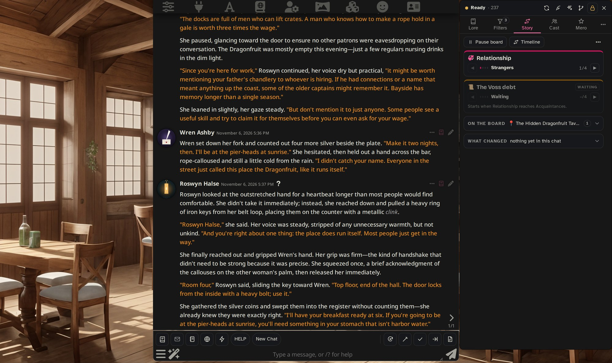
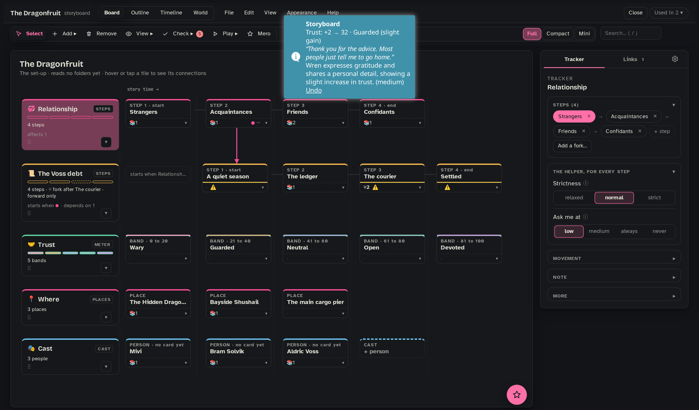
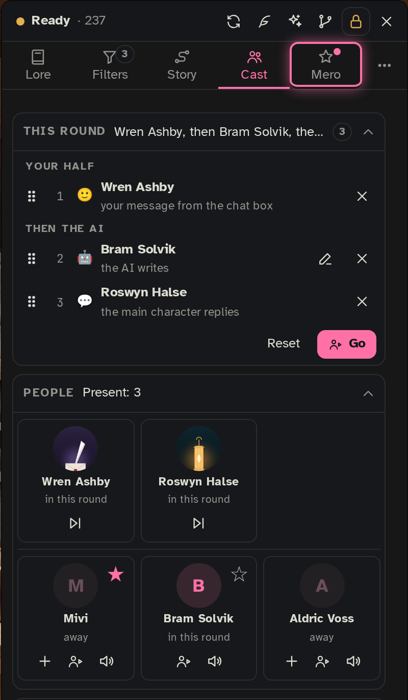
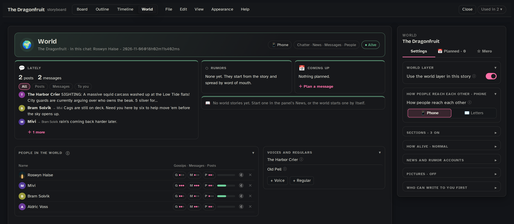
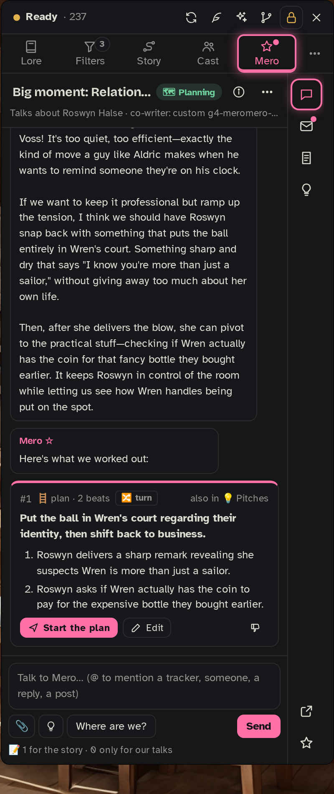
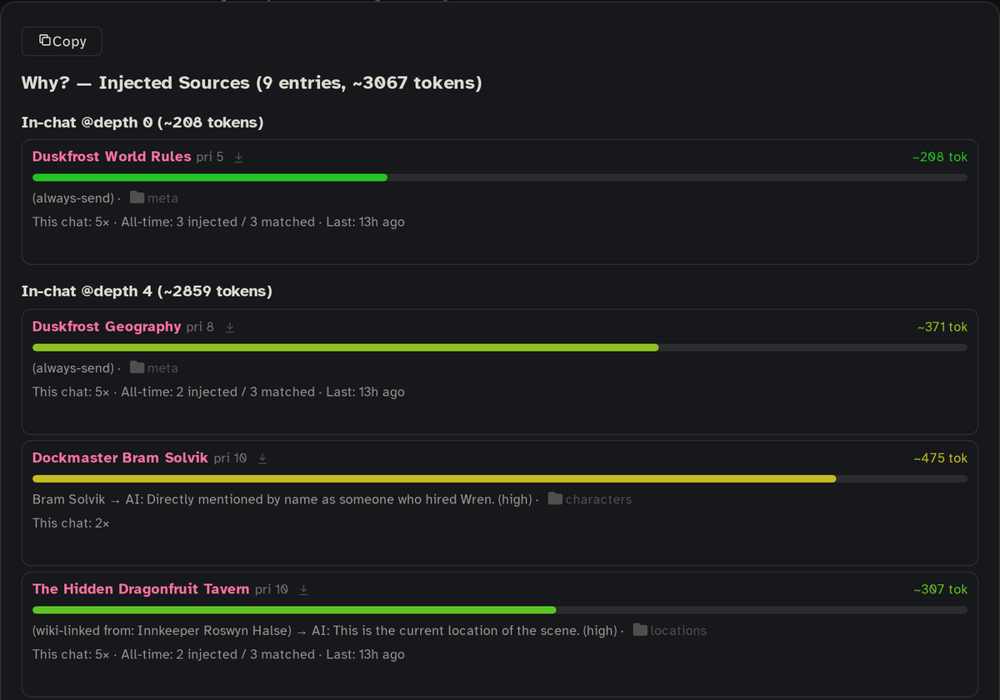
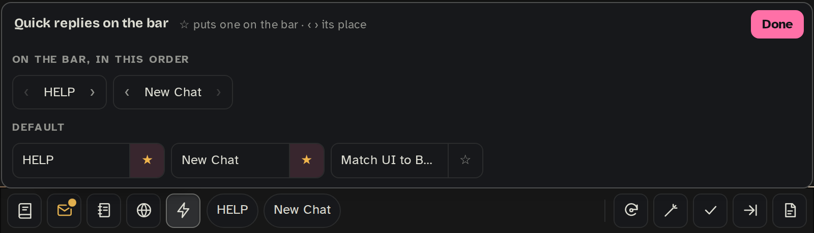
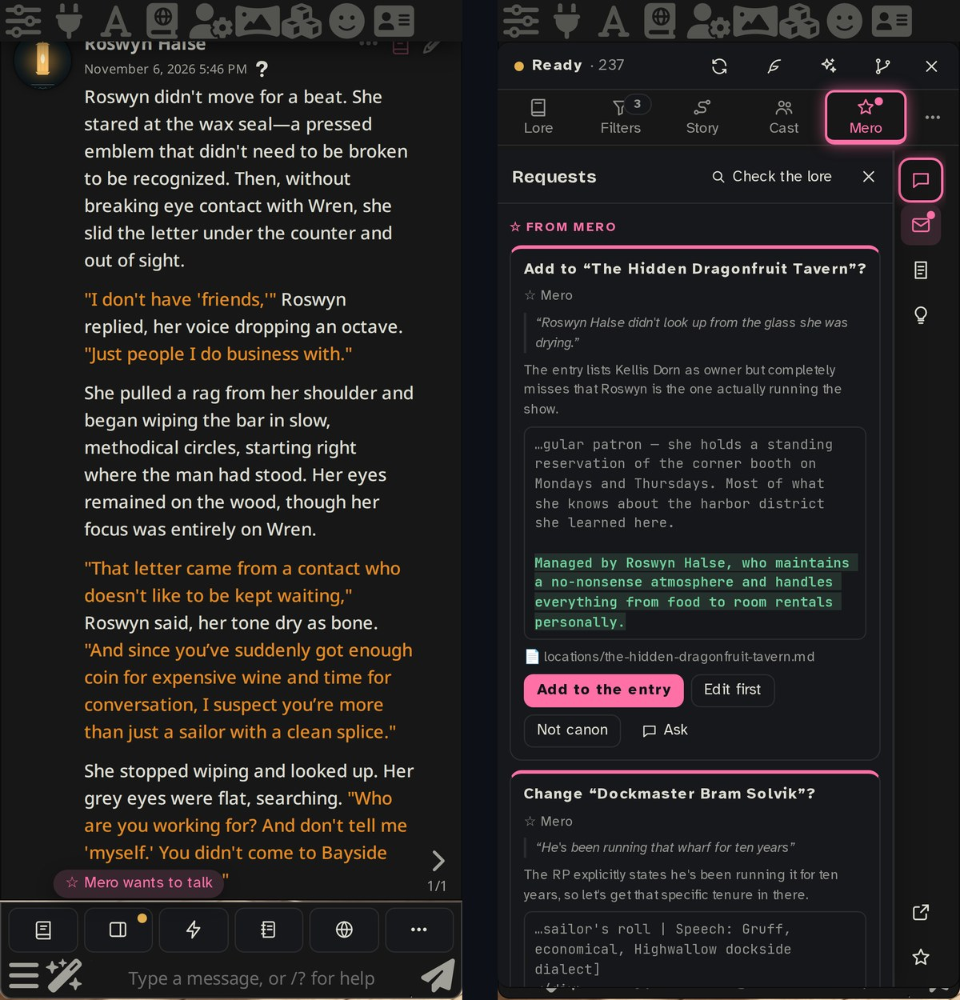

  

<h1 align="center">Onyx Quill</h1>

<b>A storyboard with AI retrieval for your long story.</b>

Built on <a href="https://github.com/pixelnull/sillytavern-DeepLore">DeepLore</a> by pixelnull. Thank you for the foundation.

  
  
  

<a href="https://github.com/Miinthe/Onyx-Quill/wiki">Wiki</a> · <a href="https://github.com/Miinthe/Onyx-Quill/wiki/Quick-Start">Quick Start</a> · <a href="https://github.com/Miinthe/Onyx-Quill/issues">Report a bug</a>

Onyx Quill is a SillyTavern extension for long stories with an AI. At its heart is the **storyboard**: you lay out where your story can go, like a relationship growing step by step, a mystery with clues to find or a quest with places to reach, and Onyx Quill follows it while you play. A helper AI notices when the story moves on, tells the writing model where things stand, and brings in the lore that belongs to that point of the story.

**Contents:** [Storyboards](#storyboards) · [Cast](#cast) · [World](#world) · [Mero](#mero) · [Lore retrieval](#lore-retrieval) · [The small things](#the-small-things) · [What it costs](#what-it-costs) · [Install](#install)

## What it does

### 🗺️ Storyboards: the plan your story follows

The heart of Onyx Quill: a board window where you lay out where your story can go, and a story helper that follows it while you play.

- **Trackers for everything:** steps (Strangers › Acquaintances › Friends), things found or owned, places, the date, counters and meters, and flags.
- **Forks and detours:** a fork splits the story, decided by the story or by a 🎲 roll. A detour is a side state, like "Not speaking" while still at Friends.
- **Connections:** "starts when the innkeeper is in the scene", "needs the key", with 🎲 odds if you like.
- **The story helper** reads each new message and moves the trackers. Every move quotes the messages word for word and shows with **Undo**, and when it isn't sure, it asks you.
- **Lore and 🧭 guidance per step:** each step brings its own entries, and guidance that tells the writer how to write this stage of the story.
- **Swipes keep their own board**, and **Re-evaluate** gives the newest reply a fresh look as a new swipe.
- **Four starter boards:** slow-burn romance, mystery, fantasy quest and slice of life.
- **New runs and branches:** start a story over in one click, or turn any message into a branch of its own.

### 🎭 Cast: the people of your story

Your NPCs live on the board. Each has their own character card and speaks in **their own messages**, with their own name and picture, instead of the main character speaking for them.

- **Wants, plans and what they know.** Every person has them, and you can edit them in place. Each thing they know remembers how they learned it: saw it, overheard it, was told, or found it out.
- **A director** keeps their plans and thoughts up to date before each reply. The writer acts on their plans but never gives them away.
- **Rounds:** pick who speaks, press **Go**, and they take turns after `{{user}}` and the main character. Write someone's lines yourself with ✍️, or let one person **Speak now**.
- **Ties:** how they feel about each other, noticed from the story as it goes, each with the line it came from and how it changed over time.
- **They come and go:** people turn up at the places they're often found or when a plan says so, and anyone who was away can tell what they've been up to.
- **Hidden** people keep their wants, plans and thoughts blurred, so your NPCs can surprise you too.

### 🌍 World: the world keeps living around your story

Set up per board, and it lives in its own panel next to the chat. Your story's people have lives of their own between scenes, and everything they do flows back into the story.

- **📱 Messages:** people text `{{user}}` and each other, or write letters if your story has no phones. Group chats, conversations between others you can read along, meet-ups that become real plans, and **Leak…** to pass a conversation on to someone.
- **💬 Chatter:** people post and comment in a feed.
- **📰 News:** the local news reports what happened. Start a world story ("twenty sheep stolen overnight") and the news follows it over several parts.
- **🗣️ Rumors** spread from person to person, and you see who heard them. **👁 Who posted?** shows who is behind an anonymous one.
- **📷 Photos** in messages: described in words, or drawn by your image generator if you have one.
- **📅 Planned:** set up a message, post, news or rumor that goes out when something happens in the story: a story day, a step on the board, a place.
- **People, voices and regulars:** dials for how much each person gossips, messages and posts, voices like a local paper or a guild board, and regulars like the town gossip.
- **It flows back:** what someone learns joins what they know in the Cast, meet-ups become their plans, and the writer knows what `{{user}}` has heard.

Off until you switch it on for a board (no button, no panel, no AI calls until then). Mero ☆ can set it up with you, and **⏸ Pause** rests it in one chat whenever you want quiet.

### ☆ Mero: your co-writer

Mero ☆ sits in the side panel, knows your board and your lore, and talks the story over with you out of character.

- **Notes for the writer:** tell her what bothers you ("you keep writing her breath hitched") and she turns it into a 🚫 Don't or 🧭 Steer note the writer follows, for as long as you choose. `[OOC: …]` in the story box reaches her too.
- **💡 Pitches:** ideas for what could happen next, shown to you or 🙈 hidden so they surprise you too, waiting for the right moment. Write your own as well; she learns your taste from 👍 and 👎.
- **🪜 Plans:** a goal with beats in order. The writer is led toward the next beat gently, over several replies.
- **She looks things up** in your lore, the board and the chat, and on the web if you allow it.
- **The glow:** after a big moment on the board, her Talks icon lights up as an invitation to talk about it.
- **Requests:** everything waiting for your answer, in one place.
- **Lore upkeep:** she suggests new entries and changes to existing ones.
- **🚫 Slop guard:** phrases the writer keeps repeating get caught.
- **🎲 Games:** Wordle and Four in a Row, for a break.

### 📚 Lore retrieval from Obsidian

The lore engine comes from pixelnull's [DeepLore](https://github.com/pixelnull/sillytavern-DeepLore). Your lore lives as notes in an [Obsidian](https://obsidian.md/) vault, and for every reply Onyx Quill picks the handful of entries the scene needs.

- **Keywords, AI search, or both.** Keywords find the candidates, then AI search (a small, fast model reading your entry summaries) keeps the ones that really fit. The right lore comes in even when nobody typed its name.
- **The story decides what's in play.** Each chat reads its own folders, and the board brings in the lore of the step you're at.
- **Your rules:** entries that need or exclude others, field values for where and when an entry applies, rests, pins and blocks, and a budget so the prompt never overflows.
- **See exactly why.** 📖 **Why these entries** on every reply shows what went in, what matched it, and what came close but stayed out. `/oq-why` previews the next reply.
- **Lore that grows as you play:** the Session Scribe writes notes of what happened into your vault, so later replies remember them.
- Bring your own vault (notes tagged `lorebook` become entries) or import a World Info book.

## The small things

- **The bar** above the message box: all your quick replies in one row, your favorites starred right on it.
- The **floating icon drawer** tidies other extensions' round buttons away.
- **✓ Fix spelling**, **🧭 Guided swipe**, and **Keep as a draft** for what you typed but aren't ready to send.
- **What you don't use stays out of your way.** Every action button on the bar can be switched off.
- **Make it yours:** your accent color, and each panel on the side you like.
- **Works on your phone.** Setting up a board is easier on a PC.

And on a phone:

## What it costs

Every AI helper is optional, and each runs on its own connection, so the small jobs can use a small, fast model.

- **Free:** picking lore by keywords, the board window, moving trackers by hand, and flipping between swipes.
- **Story helper:** one call per message you send while a board is running. Swipes, regenerates and continues don't call it.
- **AI search:** one call per reply, if you choose it over keywords alone.
- **Cast:** the director adds one call per reply while Cast people are in the scene, and each NPC message is one reply on your main connection.
- **World:** a few calls as the story goes while it is on, never while it is paused or off. It waits until your reply is written, so it never slows the chat down.
- **Mero ☆:** mostly only when you ask her. Lore upkeep looks every 5 replies by default (you can set it to only when you ask, or off), and a few small checks follow your pitches and plans.

The wiki lists every call for each part.

## Install

**You need:** SillyTavern 1.12.14 or newer, and the Obsidian app with its [Local REST API](https://github.com/coddingtonbear/obsidian-local-rest-api) plugin. **Obsidian has to be open while you play:** Onyx Quill reads your vault through it. The AI helpers are optional at first.

1. In SillyTavern, open **Extensions** → **Install extension**.
2. Paste `https://github.com/Miinthe/Onyx-Quill` and install.
3. The setup wizard opens by itself. To just look around first, pick the **Duskfrost** demo vault.

> [!IMPORTANT]
> Onyx Quill and the original DeepLore can't run at the same time. Switch DeepLore off first.

Step by step: [Installation](https://github.com/Miinthe/Onyx-Quill/wiki/Installation) · [Quick Start](https://github.com/Miinthe/Onyx-Quill/wiki/Quick-Start) · [Coming from DeepLore or World Info](https://github.com/Miinthe/Onyx-Quill/wiki/Coming-from-DeepLore-or-World-Info)

## How it was made

I made Onyx Quill with the help of Claude Code (Opus 5.5). The ideas and design, the decision making and the professionally unprofessional bug testing were all mine. :D

## Bugs and ideas

Found a bug? [Open an issue](https://github.com/Miinthe/Onyx-Quill/issues). I'm one person making this for fun, so answers are best effort.

## Credits and license

- Built on [DeepLore](https://github.com/pixelnull/sillytavern-DeepLore) by **pixelnull**: the lore engine underneath Onyx Quill started as theirs. Thank you for the foundation.
- Icons by Flaticon. The quill is Font Awesome's feather (CC BY 4.0).
- MIT license: see [LICENSE](LICENSE). Copyright pixelnull and Miinthe.
