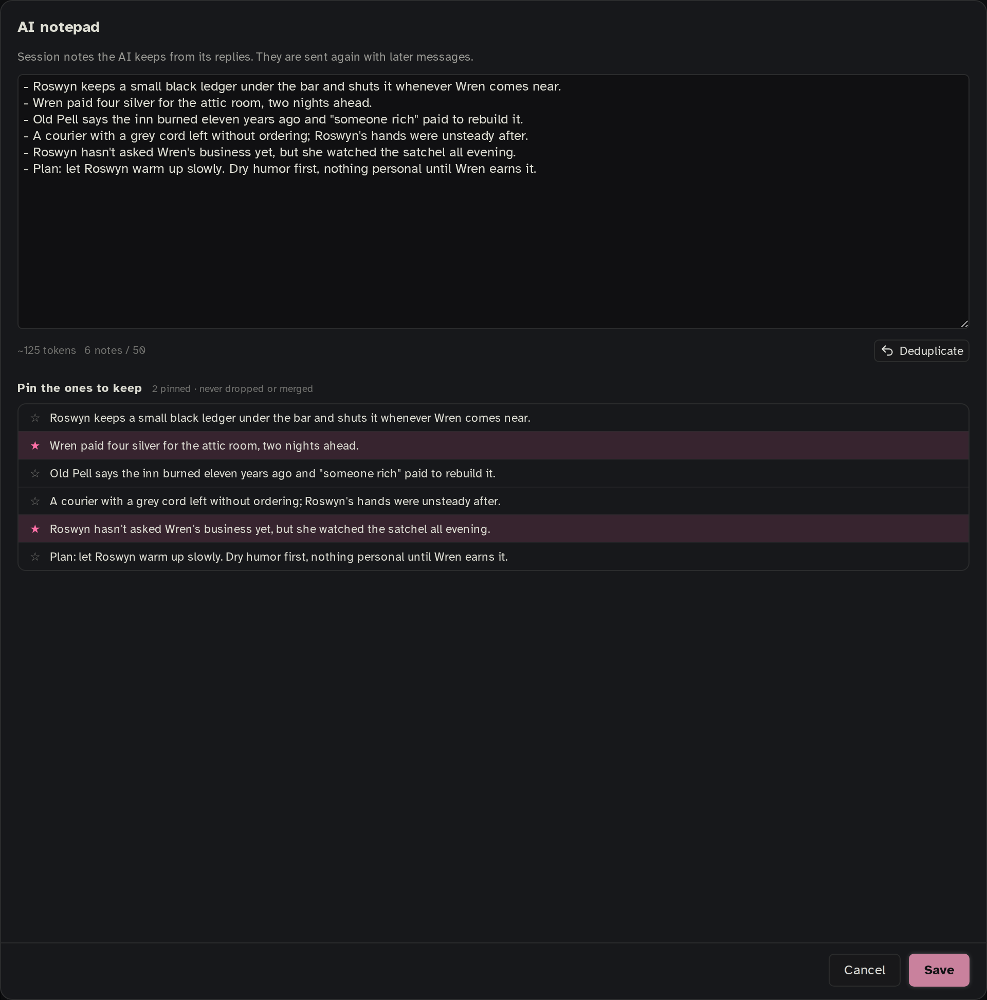

The AI notepad lets the writing model keep private notes for one chat: things it should remember but not say out loud, like a character's real motive, a promise made, a secret revealed, or a thread to come back to. The notes are hidden from the chat you see and sent back to the model with every later reply. It is off at first.

It is one of three note features, each for a different job:

- **AI notepad** (this page): notes the AI keeps for itself, per chat, sent back to the AI.
- **Author's notebook**: your own notes for one chat, sent to the AI with every reply while it is switched on (**Settings › Story & memory › Notebook and notepad**, off at first). Open it from the side panel's **⋯ › Author's notebook** or with `/oq-notebook`.
- **[[My Notes]]**: your own notes, never sent to the AI.

For longer summaries written into your vault, see the Scribe on [[Scribe and AI Helpers]].

## Turning it on

1. Open **Settings** (the bar's 📖 menu › **Setup and settings**, or the side panel's **⋯ › Settings**).
2. Go to **Story & memory › Notebook and notepad**.
3. Switch on **AI notepad**.
4. Under **How it gets its notes**, choose **tags** or **extract** (see below).
5. For **extract**, check which AI does it in **Settings › AI & connections**, on the **AI notepad** row.

## Two ways to take notes

### Tags (the default)

The writing model is told it has a private notebook. At the end of its reply it may add notes inside `<oq-notes>` … `</oq-notes>` tags. When the reply is done, Onyx Quill takes the notes out of the message, so you never see the tags, and adds them to this chat's notepad. No extra AI call.

This works best with models that follow format instructions well. A small model may forget the tags or put them in the wrong place.

### Extract

The writing model writes as usual and is told nothing about notes. After each reply, a separate AI call reads the reply (and the notes so far) and writes down what is worth remembering, or nothing if nothing is. This costs one extra AI call per reply; you can give it a cheaper model in **Settings › AI & connections**.

In extract mode, Onyx Quill also removes visible note-to-self lines from the reply before the helper reads it: `[Note to self: …]`, `[OOC: …]`, `(OOC: …)`, `[Author's note: …]`, `[Session note: …]` and `[Meta: …]`.

## Seeing and editing the notes

Open the side panel's **⋯ › AI notepad**, or type `/oq-ai-notepad`. The window shows all notes for this chat as text you can edit, with a token count and how many notes there are (out of the most it keeps). **Save** keeps your changes.

- **Deduplicate** merges notes that say nearly the same thing.
- **Pinned Entries**: tick a note to pin it. Pinned notes are never dropped when the notepad is full, and never merged away by Deduplicate.

`/oq-ai-notepad clear` empties the notepad for this chat.

The notes taken from one reply also show in that message's 📖 menu › **Why these entries**.



## How it keeps the notepad tidy

- **Per chat:** each chat has its own notepad. Switching chats switches notepads, and notes survive a page reload.
- **Swipes, deletes and edits:** when you swipe, delete or edit a reply, the notes taken from that reply are removed from the notepad.
- **A limit:** the notepad keeps the newest notes up to **Notes it keeps** (50 at first). When it is full, the oldest unpinned note drops first. Set it to 0 for no limit; a very large notepad is still trimmed from the oldest end.

## Settings

In **Settings › Story & memory › Notebook and notepad**:

| Setting | Default | What it does |
|---|---|---|
| **AI notepad** | off | Turns the notepad on. |
| **How it gets its notes** | tags | **tags**: the writer adds them, no extra call. **extract**: a helper reads each reply. |
| **Notes it keeps** (behind **More**) | 50 | The most notes kept; the oldest drop first. 0 = no limit. |
| **Count as the same note from** (behind **More**) | 0.85 | How alike two notes must be (0.1 to 1) for **Deduplicate** to merge them. |

In **Settings › Where it goes › Story state and notes** (behind **More**):

| Setting | Default | What it does |
|---|---|---|
| **AI notepad** | in the chat | Where the notes go in the prompt: before the main prompt, after it, or in the chat. |
| **Its depth** | 4 | How far up in the chat, when placed in the chat. |
| **As** | system | The role the notes are sent as: system, user or assistant. |

If you place Onyx Quill's parts in SillyTavern's prompt list (**Settings › Where it goes › How › Place Onyx Quill's parts**), these three step aside and you drag the notepad's part where you want it in the prompt list instead.

**Settings › Prompts** has both instructions: **AI notepad: tags** (what the writer is told) and **AI notepad: extract** (what the helper is told). Edit them to steer what gets noted, for example only relationship changes. **Settings › AI & connections** picks the AI for extract mode, with its own model, answer length and time limit.

## What the model sees

Each reply, the notes so far are sent like this, followed (in tags mode) by the notebook instructions:

```
[Your previous session notes]
- Kell promised to bring the ledger back before the bells ring
- The mayor knows about the smuggling but has said nothing yet
[End of session notes]
```

## Tips

- **Prune now and then.** The notepad grows with every reply. Open it, remove what no longer matters, and pin what must never drop.
- **Tags or extract?** Try tags first. If your model forgets the tags or leaves them visible, switch to extract.

See also: [[Scribe and AI Helpers]], [[Settings Reference]], [[Slash Commands]].
