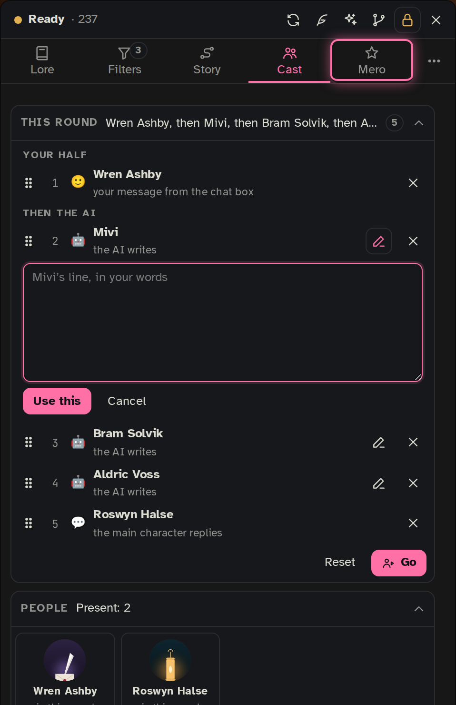

The Cast is your group of NPCs. Each person has their own character card and can speak in **their own messages**, with their own name and picture, instead of the main character speaking for them. Each person also has wants, plans and things they know, and a **director** AI keeps those up to date while you play. The Cast lives on a [[storyboard|Storyboards]] and is played from the side panel's **Cast** tab.

## Setting up a Cast

The Cast is made on the board. Open the board (bar 📖 › **Open the board**), then **Add ▸ › + Tracker… › Cast**. If there is no Cast yet, the Cast tab says so and has a button: **Add a Cast on the board…**.

Add people with **+ person**. Pick their character card (their voice comes from it) and a name on the board. A vault entry with the same name is linked by itself. Then click the person to set them up:

- **Wants, at the start** and **Plans, at the start** (plans: one per line, up to 3). Every chat on this board starts with these.
- **Often found at**: places from the board's place trackers. The director knows it, and they can turn up there by themselves.
- **When they speak**:
  - 🔔 **call only**: only when you add them.
  - ✨ **suggests themselves** (the default): offered when they want to speak; one click adds them.
  - 🎬 **steps in by themselves**: in every round while they are in the scene.
  - ✍️ **you write their lines**: the AI never does.
- **Appears by themselves**: **off**, **at their places** (a roll once per visit to where they are often found, 1 in 3 unless you change the **Chance at their places**; no AI call), or **+ when a plan says so** (the default: the director may also send them looking for `{{user}}`).
- **Hidden**: their wants, plans, thoughts and knowledge are blurred for you, so NPCs can surprise you too.
- Entries linked to them (with the kinds 📄 context, 🧭 guidance, ⚖️ judge, as anywhere on the board).

The Cast itself has **Options**:

- **The director**: on by default. Before each reply, a helper updates the plans and thoughts of the people in the scene.
- **Ties the director notices**: **ask me** (the default), **write them** or **off**. See [Ties](#ties).
- **Pin their entries while they are here**: on by default. Their linked entries always reach the writing model while they are in the scene.
- **Sets Onyx Quill's Characters Present**: off by default. When on, who is here becomes "Characters Present" in the Filters tab.
- **When is someone in the scene**: ⚖️ judge entries that tell the story helper what counts.

**🎭 Open in the Cast tab** closes the board and opens the person in the side panel.

## The Cast tab

Open the side panel and choose **Cast**. It has three folds: **This round**, **People** and **Ties**.

### This round

The speaking order for the next turn, numbered, in two halves: **Your half** (your message, and lines you write for NPCs) and **Then the AI** (the main character and the NPCs the AI writes).

- Drag the ⠿ handle to change the order (or use the arrow keys on it).
- ✍️ writes that person's line yourself. A box opens; **Use this** puts it in your half, **Let the AI write it** hands it back.
- ✕ takes someone out of this round.
- The director's suggestions show here as "✨ Mivi wants to join": **Add to round** or **No**. Someone who wants to leave: **Let them go** or **No**.
- **Go** plays the round in this order. **Send** in the chat box works too: your message, the main character, then the AI's people above.
- **Stop after this one** stops the round after the current speaker. **Reset** goes back to `{{user}}`, then the main character.

When the AI half has two or more voices, the story helper first checks who has something to add, and anyone who doesn't sits this one out (a notice says so). This applies to the main character and to people who are in the round only because they step in by themselves; people you added with **+** always speak. If `{{user}}` has left the scene, Send writes as one of the people you write yourself.

### People

Everyone always has a tile. `{{user}}` and the main character sit on their own row at the top; the Cast follows, ★ favorites first, then who is here, then who is away. The fold's summary counts everyone present.

Under each picture are small buttons (hover for their names):

- **+** puts them into this round. The AI writes their line and they stay in every round until you take them out. Someone set to ✍️ goes into your half with the writing box open.
- **Speak now**: they speak right away, in their own message.
- **Mute** (the speaker icon): they stay quiet in this chat until you add them or press Speak now. Press it again to unmute.
- **☆ / ★** makes them a favorite. This is kept on the board, so it holds in every chat that uses it.
- For `{{user}}` and the main character: **leave the scene** and **come back**. Someone out of the scene is not in the rounds, and nobody talks to them.

Tap a person's picture to open their overview:

- **In the scene**: here or away, as a switch.
- How they speak and appear (set on the board).
- **Wants**, **Plans** (up to 3) and **Knows**, all editable in place. The writing model acts on plans but never says them. Each thing they know has how they know it: saw it, overheard it, was told or found it out. **+ Something they know** adds one; ✕ forgets it.
- **Thinking**: this moment's thought, never told to the writing model.
- **While away**: what they did while they were gone. For someone away, **📜 What has Mivi been up to?** asks for it now (one helper call).
- For a hidden person, **Peek** shows their secrets to you (until the page reloads); **Hide again** covers them.

### Ties

How each Cast person feels about the others, the main character and `{{user}}`: a few words, no numbers. For example "Mivi → `{{user}}`: distrusts, but follows anyway ↗". ↗ means warming, ↘ cooling.

- **The director notices them** as part of its usual call (no extra AI call), only with the line that shows the feeling. What happens next is set on the board, under the Cast's **Options › Ties the director notices**:
  - **ask me** (the default): they arrive as ✨ suggestions in the Ties list. ✓ keeps one as a tie, ✕ turns it down, and a turned-down tie is not suggested again.
  - **write them**: they go straight in.
  - **off**: the director leaves ties alone; only yours and ✨ Suggest.
- **✨ Suggest** (under each person) asks once for starting ties, read from their character card, their lore entries and the recent chat. It costs one AI call per press, on the story helper's connection, and never runs by itself. Tap a suggestion to see where it comes from; keep or drop each one.
- **Tap a tie** to see the line it came from and the message number, and its story: the feelings it had before ("Before: strangers → friendly → now", the last 5).
- ✎ edits a tie (the old feeling goes into its story), 📌 pins it (the AI leaves a pinned tie alone), ✕ removes it. **+ Tie** adds one by hand (pinned): pick who it is toward, then write how they feel.
- At most 3 new ties a turn, 8 per person and 4 suggestions waiting per person. A hidden person's ties stay veiled until you Peek.
- **The writer gets** (the box at the bottom): the ties of people in the scene only.

## What the director does

Before each reply you send (not on a swipe or regenerate), while someone from the Cast is in the scene or someone away could come looking for `{{user}}` (**Appears by themselves: + when a plan says so**, with a plan or a want), the director reads the newest messages and, for each person there, updates this moment's thought, their plans (kept, reworded, done, dropped or new), rarely their wants, and what they learned. Anything they learn needs a word-for-word quote. It can also notice that someone left, offer people to join the round, and send an away person with a pressing plan looking for `{{user}}`.

When someone comes back after at least 4 messages away, one call writes what they did meanwhile (**While away**). All of this shows in **Story › What changed** with Undo, and deleting a message takes back what was logged at it.

## How NPCs speak

When an NPC speaks, SillyTavern writes the message as usual (streaming, stop and swipes all work), but with their prompt: their card and example messages, their plans and what they know, where the story stands, their own lore entries and the newest messages. The message gets their name and picture, and a swipe on it is them again.

On every other reply, the writing model sees their messages as someone else talking and is told not to write their lines (except for people set to 🔔 call only). After an NPC's message (or a line you wrote for them), a short check sees whether they just walked out. And when someone left in the last 3 messages, each new reply gets a short check whether it holds them back or brings them back.

NPC messages need a one-on-one chat and a Chat Completion connection for now.

## What the writing model is told

Only people **in the scene** are told to the writing model: who is here, their plans ("acts on this, never says it outright"), what they know ("anything else, they don't know"), and their ties. Never their thoughts or what they want deep down.

## What it costs

| What | When | AI calls |
|---|---|---|
| The director | each reply you send, while someone from the Cast is in the scene or someone away could come looking for `{{user}}` (switch: **The director**) | one, on the story helper's connection |
| Ties from the scene | inside the director's call | none extra |
| An NPC's message | each time they speak | one generation on your main connection |
| Who sits this round out | before the AI half, when it has two or more voices | one small call |
| Walked out | after an NPC's message | one small call |
| Held back or brought back | after a new reply, only while someone left in the last 3 messages | one small call per such person |
| While away | when someone comes back after 4+ messages, or 📜 by hand | one |
| ✨ Suggest | each press | one |
| Appearing at their places | each visit | none (a dice roll) |

The small calls run on the story helper's connection: **Settings › AI & connections › Story helper**.

See also: [[Storyboards]], [[World]], [[Side Panel]].
