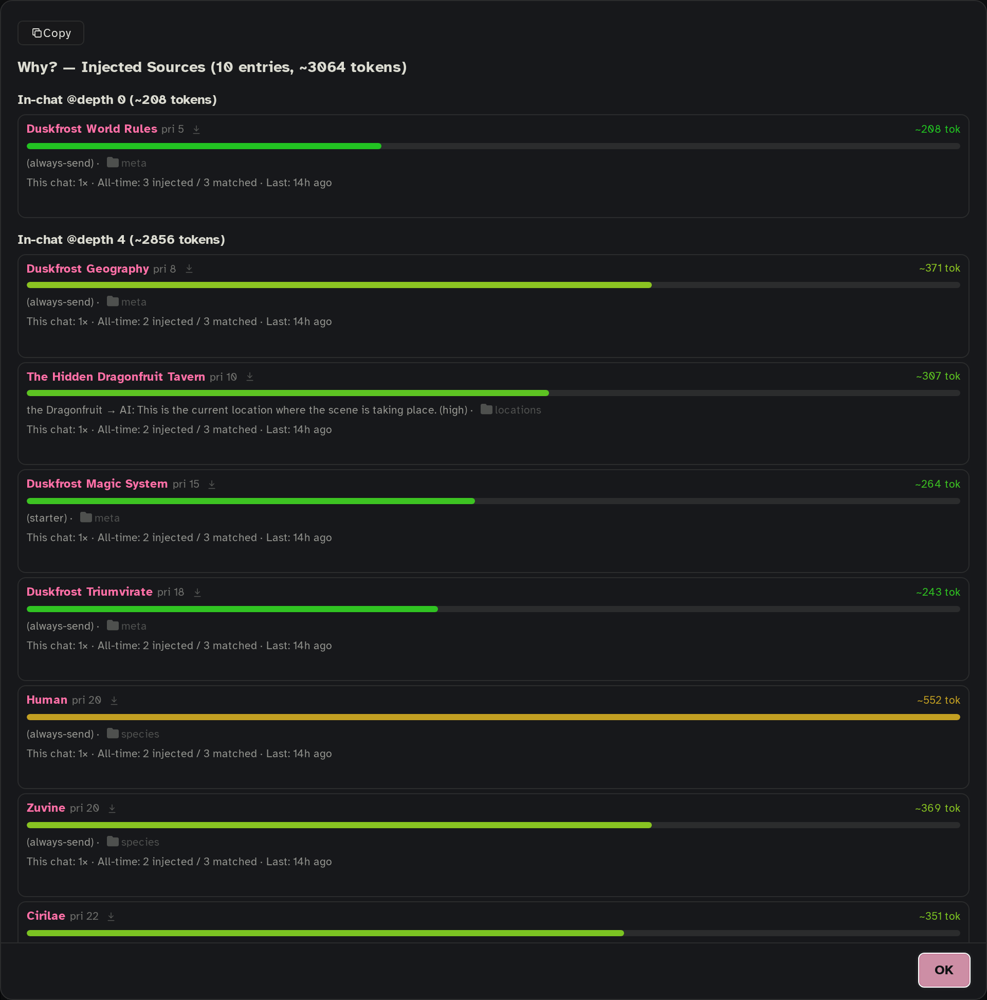
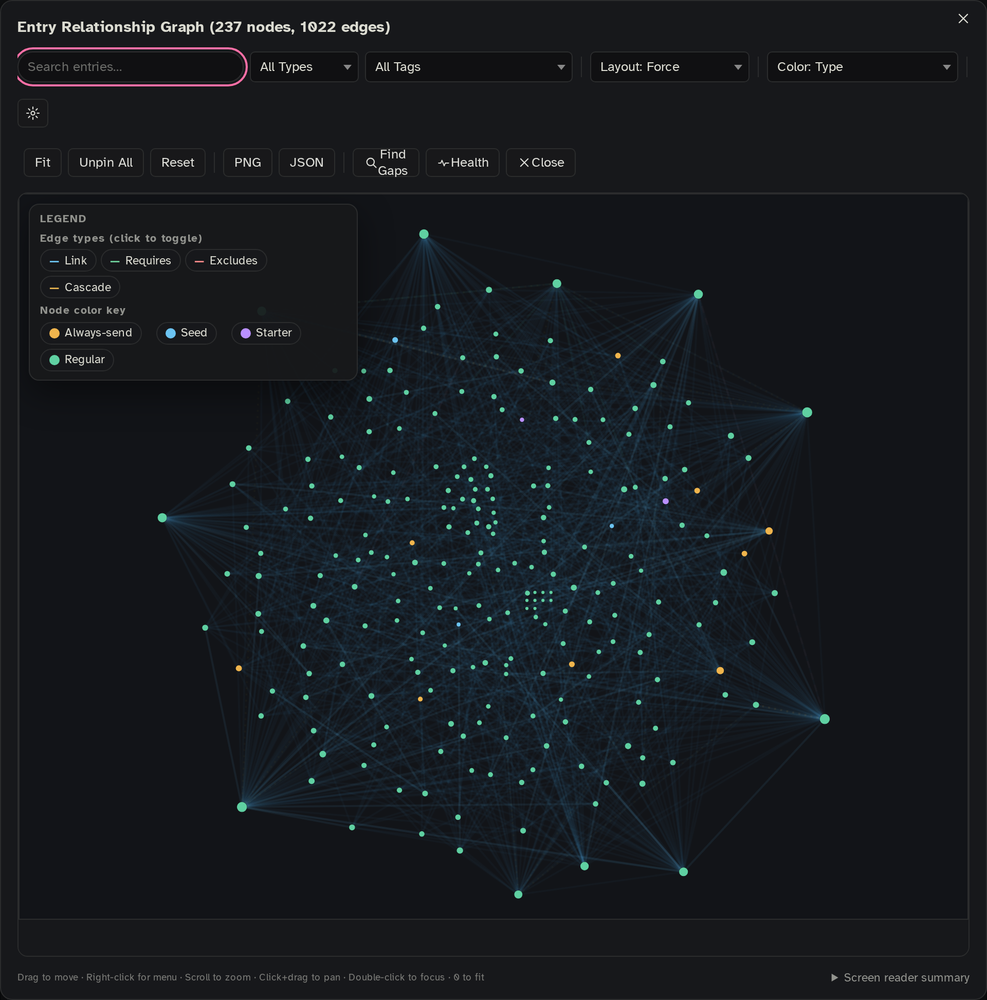

These tools show you what Onyx Quill is doing: which entries went out with a reply and why, why an entry stayed home, whether your vault and AI connections are healthy, and what to send along when you ask for help. None of them changes your lore. Most of them are a click away in the side panel or in the 📖 menu on a message; the rest are slash commands.

When something is off, this order usually finds it fastest:

1. **📖 › Why these entries** on the reply that looked wrong.
2. `/oq-health` for problems in your entries and settings.
3. `/oq-inspect` for the full story of the last lore selection.
4. **Export diagnostics** if you want to ask someone else for help.

## Why these entries (📖)

Every message has a 📖 button next to SillyTavern's own message buttons. It opens a menu for that message; **Why these entries** shows the lore that went out with it. The menu item says how many entries there were. When no lore went out it is grayed out and says "no lore used". For a Cast member's own message it says "no entries linked to them on the board" (see [[Cast]]).

The window shows:

- **What changed since the turn before**: "+N new" (with the reason each one matched), "-N removed" (with the reason it dropped), and "N same as last turn" for entries sent again.
- **The entries, grouped by where they went** in the prompt (Before Main Prompt, In-chat at a depth, After Main Prompt), with the token total of each group.
- For each entry: its name (a link that opens the note in Obsidian, see below), its priority, a token bar (colored against your vault's average), how it was picked (the keyword that matched, or AI, Constant, Pinned, Seed, Bootstrap), its folder, how often it was sent in this chat and in all chats, its keys, `requires`, custom fields and links, and a preview of the text with the matched keyword highlighted. The arrow button next to the name shows the entry in Browse.
- **Not Injected (N)**: entries that were in the running but did not go out, grouped by the reason: **Blocked by dependencies**, **Filtered by context**, **AI Rejected**, **Cooldown Active**, **Over budget**, **Already Injected**, **Probability Skipped**, **Warmup Not Met**, **Refine Key Blocked**. Each has a **Why?** button (see [Why not?](#why-not) below).
- **AI Notes (this message)**, when the [[AI Notepad]] kept notes from this reply.

The data is saved with the message, so it is still there after a reload.

**Links to Obsidian** need the vault's **Name** in **Settings › Vault** to match your Obsidian vault's name exactly. Without that, the window says "Set vault names in Vault Connections to enable deep links."

The 📖 menu has more items about the message (**What this changed**, **Guided swipe…**, **Re-evaluate and swipe** and others); those are described in [[Storyboards]] and [[The Bar]].

## The side panel: Sent, Diagnostics and Try matching

The [[Side Panel]] has three quick views:

- **Lore › Sent** lists the entries sent with the last reply. **Lore › All entries** lists your whole vault, with search.
- **Diagnostics** (the ⋯ menu › **Onyx Quill** › **Diagnostics**, or the status button at the top of the panel that says **Ready** while nothing runs) shows:
  - **This reply**: meters for **Lore budget**, **Entries** and **Context** (how full the prompt is; it fills only for connections that report prompt size), the lore selection mode and any active filters.
  - **Health**: one row each for **Vault**, **Connection**, **Lore selection**, **Cache** and **AI service**, with a colored dot. A click runs that check: **Vault** opens `/oq-health`, **Connection** opens `/oq-status`, **Lore selection** opens `/oq-inspect`, **Cache** and **AI service** show a short notice (the index's size and age; AI search's calls, cache hits and tokens).
  - **Reset the AI pause**, only while the AI is paused (see [The AI pause](#the-ai-pause)).
  - **Recent activity** (folded) and **This session** numbers (all chats, until the page reloads).
- **Try matching** (⋯ › **Tools**) is the same as `/oq-simulate`, below.

## Settings › Advanced › Troubleshooting

The settings window has the same tools in one place:

| Row | What it does |
| --- | --- |
| **Debug mode** | More detail in the browser console. Also `/oq-debug on` / `/oq-debug off`. |
| **Diagnostics** › Open | Opens the side panel's Diagnostics view. |
| **Export diagnostics** › Export | Downloads the diagnostics files (see [Exporting diagnostics](#exporting-diagnostics)). |
| **The AI pause** › Reset | Clears the AI pause after repeated AI errors. |
| **Try matching** › Open | Replays the chat (`/oq-simulate`). |

**Settings › Advanced › Reference** has **Slash commands** (the full list), **Setup wizard** and **About** (your Onyx Quill version, links to this wiki and to DeepLore).

## /oq-status

`/oq-status` shows a plain summary you can copy: whether Onyx Quill is on, the vaults that are on (with their ports), your tags, how many entries the vault has (always-send, seed, starter, secrets for Mero, total tokens), the lore budget and entry limit, chain matching, how old the index is, whether AI search is on and how many calls and cache hits it had, your custom fields, this chat's folder filter, and how often the vault is re-read.

## /oq-health (health check)

`/oq-health` (short: `/oq-h`) checks your entries and settings for common mistakes and lists errors, warnings and info, grouped by kind. Errors are open by default; the chips at the top hide or show each severity, and each row has a button to copy the entry's name.

It finds things like:

- **Settings**: no vault switched on, a vault without an API key, nothing that could ever match (**Messages to read** at 0 with AI search off), AI search alone picking lore without a connection, a very low lore budget, an index far older than **Keep the index for**.
- **Entries**: duplicate titles, entries without keywords or without text, `requires` / `excludes` / `cascade_links` that point to entries that don't exist, an entry that requires and excludes the same entry, two entries that require each other, an entry that excludes itself, wiki-links that lead nowhere, very large entries (over 1,500 tokens), missing summaries, very short or shared keywords, settings that do nothing (a depth or role without the in-chat position, a cooldown on an always-send entry, probability 0).
- **Size**: always-send entries that alone go over the lore budget.

Run it after adding or changing entries, or when an entry doesn't behave. The demo vault's `_edge-cases` folder has one note for most of these, if you want to see them.

## /oq-inspect

`/oq-inspect` (short: `/oq-i`) shows everything about the last lore selection in this chat:

- The mode (keywords only, keywords then AI search, AI search only), how many entries the vault has, whether starter entries were active, and whether AI search failed and the keyword picks were used instead.
- **Stage Timing**: how long each step took.
- **Keyword Matched**, with the keyword that matched each entry; loose matching (fuzzy search) numbers when it is on.
- What AI search picked, with how sure it was and why.
- **Injected**, with the token total against the budget.
- What each later step removed: **Contextual Gating Removed**, **Re-injection Cooldown**, **Gated Out** (requires / excludes), **Probability Skipped**, **Warmup Not Met**, **Budget/Max Cut**, **Refine Key Blocked**. The copied text also has the folder filter (which folders, how many entries it left out).

There is a copy button for the whole trace as text.

## /oq-why

`/oq-why` (also `/oq-context`) previews the entries the **next** message would get right now, in the same window as **Why these entries**. It uses the same things the real reply would: the chat's folders, the board (where the story stands, items, pins), your pins and blocks, and this chat's budget. When AI search is on, it asks first, because the preview makes a real AI call.

## Why not?

**Why?** buttons (in **Why these entries** and `/oq-browse`, where it says **Why not injected?**) walk one entry through the steps of lore selection and stop at the first one it fails. It names the step in plain words and, where it can, suggests a fix:

| What it finds | What it means |
| --- | --- |
| No keywords | The entry has no trigger keywords. |
| Scan depth is 0 | **Messages to read** is 0, so keywords never match. |
| Keyword miss | None of its keywords are in the last messages it reads. If one is a bit further back, it says so. |
| Refine keys | A keyword matched, but the refine keys (with the entry's `selective_logic`) blocked it. |
| Warmup | The keyword did not appear often enough yet. |
| Probability | It lost its chance roll this time. |
| Cooldown | Its own cooldown has replies left. |
| Rest after sending | It went out recently and is resting (**Settings › Budget & variety › Rest after sending**). |
| Requires / excludes | An entry it requires isn't there, or an entry it excludes is. |
| AI rejected | AI search saw it and did not pick it. A better `summary` helps. |
| Secret for Mero ☆ | It has the `lorebook-guide` tag: only Mero reads it, the writer never gets it. |
| Folder filter | It is in a folder this chat doesn't read. |
| Blocked | It is blocked in this chat. |
| Filtered by context | A field filter (era, location, scene, character, your own fields) left it out. |
| Over budget | It passed everything but didn't fit the lore budget or the entry limit. |

## /oq-simulate (Try matching)

`/oq-simulate`, or **Try matching** in the side panel and in **Settings › Advanced**, replays your chat from the first message to the last and shows, message by message, which entries switch on (green) and off (red). Use it to find keywords that fire too early, too late, never, or flicker on and off. There is a copy button for the timeline.

It uses keywords only, with your current **Messages to read** and each entry's own scan depth, and keeps to what this chat reads: its folders, today's pins, blocks and field values, requires and excludes, and its budget. Secrets for Mero ☆ are never part of it. It can't replay where the board stood at each past message, so board steps and board pins are left out (the window says so). It skips AI search, chance rolls, warmup and cooldowns, so the result is the same every time.

## /oq-browse

`/oq-browse` (short: `/oq-b`) opens your whole vault in a searchable list: search titles, keywords and text; filter by status (pinned, blocked, always-send, seed, starter, regular, never sent) and by tag; sort by priority, name, token size or how often an entry was sent. Each entry unfolds to its text, keywords and an Obsidian link, has pin and block buttons for this chat, and (except always-send entries) a **Why not injected?** button. The side panel's **Lore › All entries** gives you the same while you chat.

## /oq-graph (the graph)

`/oq-graph` (short: `/oq-g`), or **Graph** in the side panel's ⋯ menu, draws your entries as a map: dots for entries, lines for links, `requires`, `excludes` and cascade links. Drag, zoom and pan. The toolbar has a search, filters by type and tag, two layouts (Force and Layered DAG), color by type, priority, connections, how often an entry is sent, or clusters, **Fit**, **Unpin All**, **Reset**, PNG and JSON export, **Find Gaps** and **Health**. Click an entry to focus on it and its neighbors; **Esc** or **e** leaves focus. **Settings › Interface** has the graph's finer settings.

## /oq-analytics

`/oq-analytics` lists every entry with how often it matched, how often it was sent, and when it was last used, plus a **Never Injected** list with each entry's keyword count and priority. Good for finding entries whose keywords never fire. The numbers are kept in your settings across sessions.

## /oq-lint

`/oq-lint` (short: `/oq-l`) lists the warnings and skipped notes from the last time the vault was read: broken frontmatter, unreadable YAML and similar. When a re-read reports warnings or skipped notes, this is where you see which files and why.

## Logs and debug mode

- `/oq-logs [count]` shows Onyx Quill's recent lines from the browser console (50 by default, up to 500), with a copy button.
- **Debug mode** (**Settings › Advanced**, or `/oq-debug`) writes much more detail to the browser console. Turn it on only while you chase a problem.

## Cache commands

- `/oq-cache-info` shows the saved copy of your vault in the browser: how many entries, how old, how much browser storage is used, with a **Clear Cache** button.
- `/oq-clear` empties that saved copy and the loaded index without reading the vault again. `/oq-refresh` (short: `/oq-r`) reads the whole vault again from Obsidian.

## Exporting diagnostics

`/oq-diagnostics` (short: `/oq-diag`), or **Settings › Advanced › Export diagnostics**, downloads two files:

- `onyx-quill-diagnostics-<time>.md`: the report, made anonymous, meant for sharing (for example in a bug report).
- `onyx-quill-connections-reference-<time>.md`: your real connection names and settings, **for your eyes only**. It lets you match the report's placeholders to your real setup. Don't share it.

The report has your Onyx Quill and SillyTavern versions, your setup, the connection each job uses, a summary of your vault (counts, sizes, problems), the health check, key settings, installed extensions, a record of the recent replies' lore selections, and recent log, network, error and AI call records. A large part is packed as a compressed block at the end; any capable AI chat can unpack and read the whole file, and the file includes instructions for it.

**What is removed before writing:**

- Replaced with `<redacted>`: API keys, tokens, passwords, cookies, `Authorization` headers, long secret-looking strings, and known key formats.
- Replaced with placeholders like `<ip-1>`, `<host-2>`, `<title-3>`: IP addresses, host names, email addresses, home folder paths, and your entry titles and file names. The same real value gets the same placeholder within one report, so a reader can still see "the same entry was picked 12 times". Every report uses new placeholders, so two reports can't be matched to each other.
- Your own prompt texts appear only as their length.
- Never read into the report at all: your chat messages, your entries' text and their summaries.

A notice after the download says how much was anonymized.

**Check before you share.** The log and network sections also hold recent lines from SillyTavern itself and from other extensions. They go through the same cleaning, but if another extension wrote chat text into the console, it can show up there. Skim those two sections first. The report says so at the top too.

Bug reports go to the [Onyx Quill issues page](https://github.com/Miinthe/Onyx-Quill/issues).

## The AI pause

When the AI that picks lore fails twice in a row from the service's side (server errors, network errors, replies it can't read), Onyx Quill pauses its AI for 30 seconds and meanwhile goes by **If AI search fails** (by default, the keyword picks). A notice says "AI search is resting after errors — using keywords for now." After the pause, one call tries again; if it works, everything carries on and a notice says it is back. Time-outs, rate limits, a refused API key and pressing Stop don't count toward the pause. AI search, Scribe, New lore and **Write missing summaries** share this pause. To end it early: **Reset the AI pause** in the Diagnostics view, or **Settings › Advanced › The AI pause › Reset**. More in [[Under the Hood]].

## See also

- [[Troubleshooting]] for fixes, problem by problem.
- [[How Lore Gets Picked]] for what each step does.
- [[Slash Commands]] for every command.
