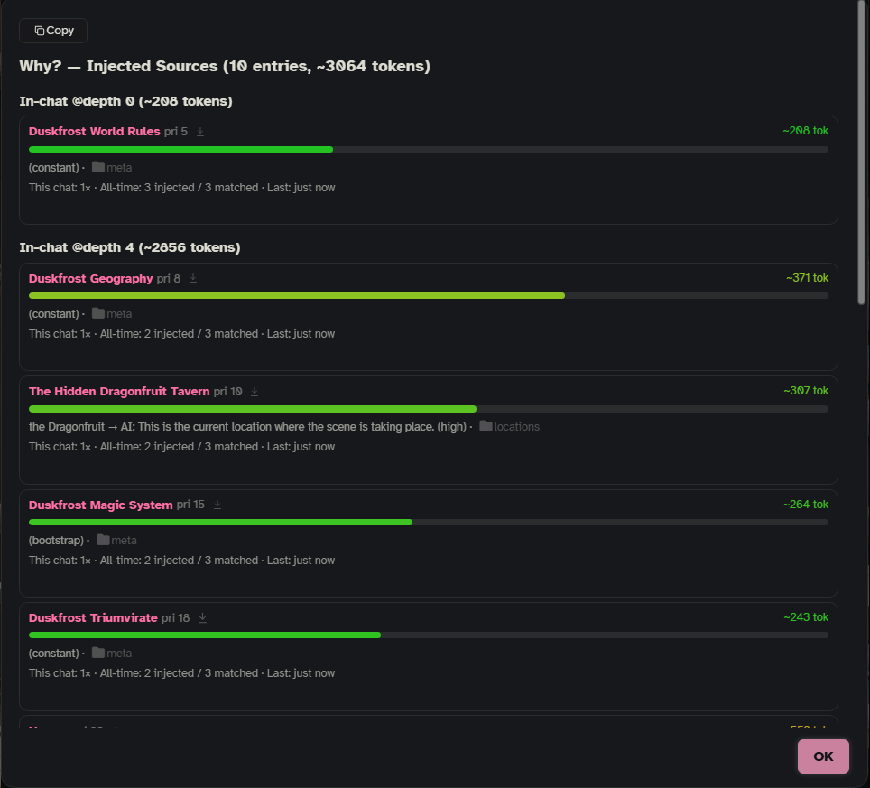

Every time the writing AI writes a reply, Onyx Quill picks a handful of entries from your vault and sends them along. This page explains how that choice is made, in the order it happens, and which settings and buttons change it. It is written for writers; the technical details are on [[Under the Hood]].

## The short version

For each reply, Onyx Quill:

1. Checks that it is **on for this chat**. A character chat needs at least one folder to read.
2. Narrows the vault to **what this story reads**: the chat's folders, and what the board allows right now.
3. Adds the **always-send** entries, and the **starter** entries while the chat is new.
4. Finds the entries that fit the scene: by **keywords**, by **AI search** (an AI that reads your entry summaries), or keywords first and then AI search.
5. Applies your rules: field values, `requires` / `excludes`, rests, pins and blocks.
6. Fills the **budget**: the most important entries first, until **Entries per reply** or the **Lore budget** is full.
7. Puts the entries **in the prompt** where **Settings › Where it goes** says.

Afterwards you can see exactly what went in, and why, from the 📖 button on the reply: **Why these entries**.

## Is Onyx Quill on in this chat?

Onyx Quill reads lore by **folders**. A chat reads:

- the character's **base folders** (every chat with this character),
- the **run's** folders, when the chat has a run letter,
- and **this chat's own** folders.

All of them count together. A character chat with **no folders anywhere** does not use Onyx Quill at all: no lore, no trackers, nothing. A group chat has no character, so only its own folders apply, and with none set it reads the whole vault.

Entries at the top level of the vault (not inside any folder) always count as inside. Always-send, seed and starter entries follow the folders like every other entry, so one story's always-send entries never reach another story. Only entries you pin in this chat are sent whatever the folders say.

You set all of this in the side panel's **Filters** tab: the card on top shows **Base folders**, **Run … adds** and **This chat adds**, how many entries are **Left out**, and the switch **Onyx Quill in this chat** (like the character · always on · off). **Change folders and fields…** opens the folder pickers. **Settings › Filters** shows the same for every character and run. The commands `/oq-set-folder` and `/oq-clear-folder` set or clear this chat's own folders. See [[Side Panel]].

## Three ways to pick

**Settings › Lore selection › Mode › How lore is picked** has three choices:

| Choice | What happens | Cost |
|---|---|---|
| **keywords only** | An entry goes in when one of its `keys` appears in the recent messages. | Free, instant. |
| **keywords, then AI search** | Keywords find the candidates; AI search then chooses the ones that really fit. | One extra AI call per reply. |
| **AI search only** | AI search reads a short card for every entry in play and chooses, no keywords needed. | One extra AI call per reply, with a much longer list. |

A fresh install uses **keywords only**. The [[Setup Wizard]] asks which one you want. Most writers who have a spare model for it use **keywords, then AI search**: keywords keep the list short, and AI search throws out the matches that only look right.

## Keywords

Onyx Quill reads the last few messages (**Messages to read**, 4 by default) and looks for each entry's `keys` in them.

- Keywords are plain text, not case sensitive, and match **anywhere**, also inside longer words: the key `Bram` also matches "Brambles". Turn on **Whole words only** (under **More**) if that bothers you. A key with a space in it is always matched as a phrase.
- The speaker's name is part of what is read. A key that is the name of someone who speaks in every message matches every reply. Use names that appear when the person is *talked about*, or use field filters and pins instead (see below).
- **Match the active character** also sends the entry whose title or key is the open character's name, even when nobody says it.
- **Loose matching** also finds entries whose words are close to the chat, not only exact keywords. **How close** sets how strict it is (low = more matches).
- **Entries can call other entries** (under **More**): the text of a matched entry can match further entries, up to the number of steps you set (0 = off).
- In **keywords, then AI search** mode, entries that a matched entry links to with `[[wikilinks]]` are also handed to AI search as candidates.

Each entry can bend these rules for itself: `scanDepth` (read more or fewer messages), `refine_keys` (a second keyword check), `warmup`, `probability`, `cooldown`, `cascade_links`. See [[Advanced Gating]].

## AI search

AI search is an AI that picks lore. It never sees your full entries. It gets a short card for each candidate (the title, its size, the entries it links to, any field values, and the `summary`, or the start of the text when there is no summary) plus the last few messages (**Messages AI search reads**, 4 by default). It answers with the entries it wants, each with a reason and how sure it is (high, medium or low).

- Set up which AI does this in **Settings › AI & connections**, the **AI search** row ("picks the lore for a reply"). A small, fast model is enough.
- **Its prompt › Preview** (in **Settings › Lore selection**) shows exactly what AI search is sent for this chat.
- **Leave out below** drops picks AI search is unsure about (default: low, keep all).
- AI search is asked for up to twice your **Entries per reply**, sure picks first, so the budget can cut the unsure ones.
- **If AI search fails** (default: use the keyword picks) and **If AI search picks nothing** (default: always-send entries only) decide what happens then.
- **AI search reads** chooses between the summary, else the text (default), summaries only, or the text only. **Entry text it reads, at most** caps how much of the text is sent when an entry has no summary (600 characters); a written `summary` is sent whole.
- **Give it the session notes** also hands AI search Scribe's latest session notes. See [[Scribe and AI Helpers]].
- A swipe or regenerate of the same reply reuses AI search's last pick instead of asking again.

Good summaries make AI search good. See [[Writing Vault Entries]].

In **AI search only** mode no keywords are read, so the per-entry keyword rules (`refine_keys`, `warmup`, `probability`, `cooldown`, `cascade_links`) do nothing there.

## New chats: starter and seed entries

While a chat is new (**Settings › Vault › Tags › A chat counts as new for**, 3 messages by default):

- Entries tagged `lorebook-bootstrap` (**Starter tag**) are sent with every reply, like always-send entries. After that they are ordinary entries again.
- Entries tagged `lorebook-seed` (**Seed tag**) are given to AI search as background on the setting, so it chooses better from little chat. They are not sent to the writer for that. This only matters when AI search is on.

Entries tagged `lorebook-always` (**Always-send tag**) go in with every reply, in every chat that reads their folder (or every chat, if they sit at the top of the vault). See [[Frontmatter Fields]] for all tags.

## How much: the budget

**Settings › Budget & variety › Budget**:

- **Entries per reply** (10 by default) and **Lore budget** (3072 tokens per reply) are the two limits. **No limit on entries** and **No limit on tokens** switch them off.
- Entries are taken in **priority** order: a lower `priority` number goes first (100 when an entry has none). **Higher priority number wins** (under **Lore selection › More**) turns that around.
- When the next entry does not fit the token budget, it is shortened at the end of a sentence if there is still room for a useful part (about 50 tokens); otherwise it is left out.
- Entries placed with `outlet` don't count against either limit.

A character or a single chat can have its own budget: **This chat · a character** at the top of the Budget card. The most specific wins: this chat → its character → Everywhere.

## Variety

The same entries can fit many replies in a row. They are then sent again, because the prompt is built fresh for every reply. **Why these entries** lists them as "same as last turn". To give other entries a turn:

- **Rest after sending** (replies, 0 = off): after an entry is sent, it waits this many replies before it can go in again.
- **Give others a turn**: marks entries on AI search's cards as sent many times in a row, or not sent for a long time, so AI search can mix things up. **Bring one back after** and **Hold one back after** (under **More**) set when. This only works with AI search; with keywords only it changes nothing.
- A single entry can rest on its own with `cooldown`. See [[Advanced Gating]].

Always-send, seed and pinned entries never rest, and neither do starter entries while the chat is new. Rests start over when you switch chats or reload the page.

## Steering one chat

**Pins and blocks.** A pinned entry goes in with every reply in this chat, whatever the keywords or AI search say. A blocked entry never goes in, not even an always-send one. In the side panel's **Lore** tab, tap an entry for **Pin** and **Block**, or use **Select** for several at once. The commands are `/oq-pin`, `/oq-unpin`, `/oq-block`, `/oq-unblock` and `/oq-pins` (lists both). Pinned entries still count against the budget; they get priority 10, so they usually make the cut.

**Field values.** Entries can carry fields like `era`, `location`, `scene_type` or `character_present`, or fields you made yourself. Set a value for this chat (side panel **Filters** tab, **Fields** fold, or `/oq-set-field`), and entries with a different value stay out. See [[Custom Fields]].

**The board.** When the chat has a storyboard, it steers lore too: entries linked to a step are only in play while the story is at that step, 📌 pinned links are sent while it is there, entries linked to an item come in once it is found, and the entry of the place the scene is at is sent. ⚖️ judge links never reach the writer, and 🧭 guidance goes to the writer as instructions in the story block, not as lore. The Cast can fill in who is present. See [[Storyboards]] and [[Cast]].

Notes tagged `lorebook-guide` (**Secrets for Mero ☆**) are never picked: only Mero reads them. See [[Mero]].

## Where entries go in the prompt

**Settings › Where it goes › Lore entries**:

- **Position**: before the main prompt, after the main prompt, or in the chat (the default).
- **Depth** (4 by default) and **As** (system, by default) when the position is in the chat.
- **How each entry is written** (under **More**): the wrapper around each entry, with `{{title}}` and `{{content}}`. The default writes `<Title>` … `</Title>` around each entry.

A single entry can choose its own place with `position`, `depth` and `role`, or go exactly where you put a `{{outlet::name}}` macro with `outlet`. See [[Advanced Gating]].

**Place Onyx Quill's parts › in the prompt list** (Chat Completion) lets you drag Onyx Quill's parts into place in SillyTavern's prompt list instead; the positions here then don't apply. Lore shows up there as **Onyx Quill Constants** (always-send and pinned entries) and **Onyx Quill Lore Entries** (the rest); entries with their own position keep it. The same section also places the **Story trackers block**, the **Author's notebook** and the **AI notepad**. See [[Settings Reference]].

## Seeing what happened

- **📖 › Why these entries** on any reply: what went in, grouped by where it went, with size and priority; **matched by** (the keyword, `AI:` with AI search's reason, `(pinned)`, `(constant)`, `(cascade from: …)`, `(wiki-linked from: …)` and so on); what is new, dropped, or the same as last turn; and under **Not Injected**, the entries that came close and why they stayed out (blocked by dependencies, filtered by context, rejected by AI search, resting, over budget, warmup not met, probability). Each has a **Why?** button.
- The side panel's **Lore** tab: **Sent** (the last reply), **Left out** (with **Let it in next time**, which pins it), **All entries**, and a **Timers** fold for entries that are resting.
- `/oq-why` previews what the next reply would get, `/oq-inspect` shows the full trace of the last one, and `/oq-simulate` replays the chat message by message.

More in [[Diagnostics]]. If lore seems missing, start at [[Troubleshooting]].
