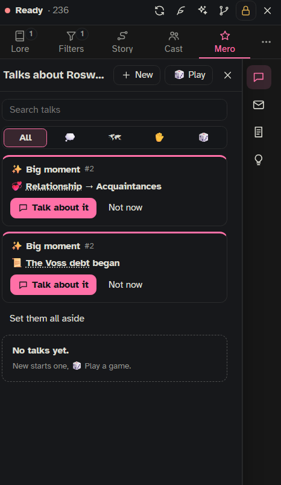
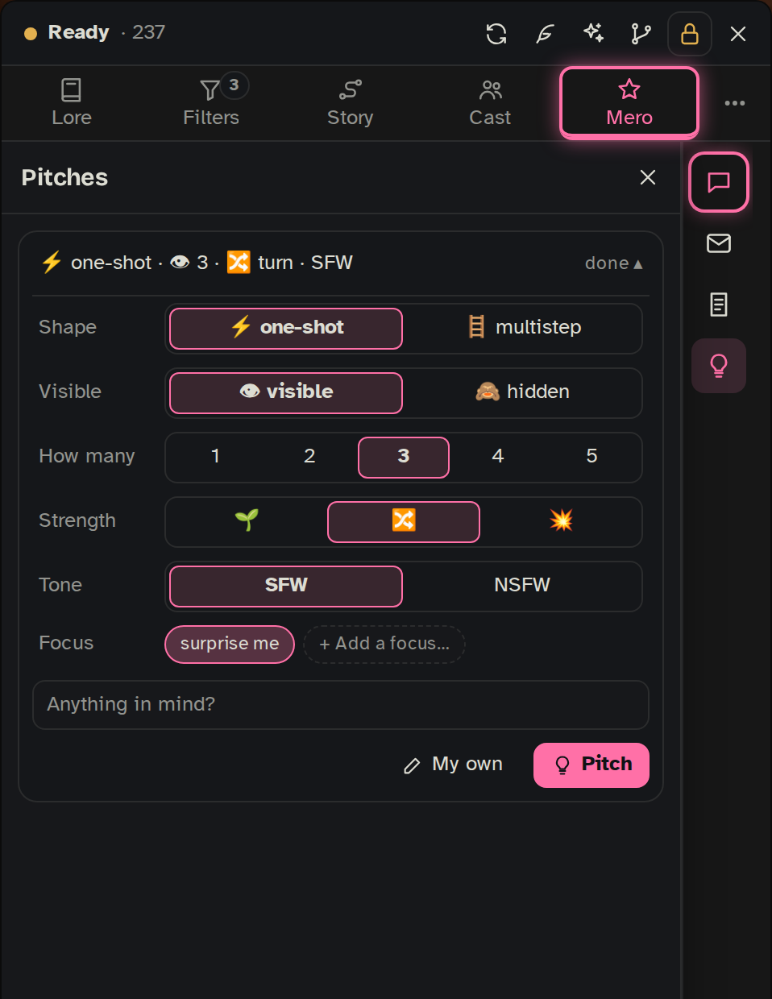

Mero ☆ is your co-writer. You talk with her about the story out of character, ask her for ideas (pitches) and plans, keep notes that steer the writer, and let her look after your lore. What you say to her stays between you two: only the notes you keep, the pitches you send and the lore changes you accept ever reach the story.

## Where to find her

- **The side panel's Mero tab.** Her talk fills the tab; a row of icons on the outer edge (her rail) opens her drawers. A dot on the tab means she has something for you; it turns amber while a reply waits for your answer.
- **Pop out** (on her rail): Mero in her own window, so you can keep her open beside the chat.
- **The 📖 menu on a message**: **Pitch from here** asks for pitches grown from that message, and **Ask Mero about this** opens her with the message attached.
- **On the board**, the **Mero** tool (key **M**) opens her to help you set up the board. That part is described on [[Storyboards]].

**Her AI** is picked in **Settings › AI & connections**, on the **Mero ☆** row: a SillyTavern connection profile. Until one is picked she can't answer; the Pitches drawer also offers a picker for a first pitch. Her name is always Mero.

## Talking with her

Type in **Talk to Mero…** and press **Send**. "☆ Mero is typing…" shows while she works. Talks live with the character, so every chat and run of that character sees the same talks.

Under the box:

- **@** mentions something so she gets it with your message: `@cast-` (someone in the [[Cast]]), `@tracker-` (a tracker and where it stands), `@reply-#12` (a message from the last 40), `@lore-` (an entry this story reads, the board's first), and from the [[World]] `@messages-`, `@post-`, `@rumor-`, `@news-`. Type just `@` to see the list.
- **📎** adds context by pointing: press it, then click a message in the chat, a post or conversation in the World panel, or a lore entry.
- **Pitch** turns what you two worked out in this talk into pitch cards (see [Pitches from a talk](#pitches-from-a-talk)).
- **Where are we?** asks for a short recap: where each running tracker stands and how long since it moved, open threads, what is coming up, and whether the story has wandered off the board.

At the top of the talk:

- **The title.** Mero names a new talk from your first message (marked ✨); click it to rename, and she won't change it again.
- **The kind of talk**: 💭 Yapping, 🗺 Planning or ✋ Feedback. Mero sets it herself as the talk goes; it only sorts your list. She reads the room either way: a hello gets a short hello, planning gets a thinking partner who sums up what is settled, "I don't like that reply" gets an out-of-character look at what went wrong.
- **She builds with you.** When you say what you want (a plan, a scene, an event), she builds it right away from what you gave her instead of questioning it, and asks at most one question, after she has built something. A plan for later is planned forward from your idea, even when the current scene looks different. If an idea clashes with the story she says so once, briefly, then helps with what you chose.
- **ⓘ** shows what Mero was told for her last answer, section by section, including the Secrets for Mero ☆ she was given. On top sits her summary of the board (one line per tracker). She keeps it up to date when the board changes; if it is wrong, edit it and press **Keep my version** (it then counts for every talk on that board). **Write it again** and **Back to Mero's** undo your edit.
- **⋯**: **Check the lore** (see [Lore upkeep](#lore-upkeep-her-job)), **Wrap up** (she offers what you agreed as note cards), **Resolve for now** (writing in the talk opens it again), **Archive** and **Delete**. Deleting a talk that notes were made from asks what happens to those notes: keep them, archive them, or delete both.

Her **bold** and *italics* show as such.

### What she knows

For every answer Mero gets: who she is (Settings › Mero), her notes just for your talks, the notes the writer follows right now, your [Secrets for Mero ☆](#secrets-for-mero-), her summary of the board and where each tracker stands, what the writer is told about the story's state, recent big moments, a summary of the World (when the world layer is on), the lore entries sent with the last reply, the character card and your persona, and the latest replies (12 by default; `[OOC: …]` brackets are taken out). Entries whose keywords your message names are handed to her too, found the same way lore is picked for the writer (no AI call).

She reads only the lore this story reads: the chat's folders and the same field gating as the writer's lore (see [[How Lore Gets Picked]]). Entries linked on the open board stay readable for her even where the field gating would hide them (they still have to be in those folders), and come first when she searches. The 📎 picker and `@lore-` offer only those entries too.

### She looks things up

When her AI can do it, Mero looks things up before she answers: she searches and reads this story's **lore** (the board's entries first), opens any **tracker** of the board, searches and reads the **whole chat** (not only the latest replies), and checks someone in the **Cast**. She only reads; a lookup never changes anything. She makes at most 8 lookups for one answer.

- While she works, each lookup shows as its own line under "Mero is typing…".
- Afterwards her answer's header says **🔎 3 lookups**; click it to see what she looked at and what she found.
- **🔎 lookups off** means her connection can't do lookups. They need a Chat Completion profile whose model accepts tools; some local models don't. A profile that refused once is remembered until you reload the page.
- **🔎 no lookups this time** means the AI service was busy or slow; she answered without them and tries again next time.
- **🌐 The web.** For a real-world fact (the official lore of a book, film or game your story is based on, a real place, a word), she can search the web and read a page. It uses the search service set up in SillyTavern's **Web Search** extension; the extension doesn't have to be switched on for your chats, its search just has to be set up. Your lore, board and chat always win over the web. Some sites refuse to be read this way; she then has only the search results. Turn it off in **Settings › Mero › Her job › Searches the web**.

### Her questions

When she needs to know something with a few clear answers, she asks with a **question card**: pick one (●) or several (☐), or type **your own answer**. **Anything to add?** takes extra details. **Send answers** sends your picks as your message, and she answers it. Answered cards stay, showing what you picked.

### Each message's buttons

Hover a message (tap on a phone) for its buttons:

- On Mero's last answer: **↻** answers again. The old answer stays as a swipe (**◀ 1/2 ▶**) until you write again.
- On your message: **✏** edits it. On your last message, **Save & ask again** removes what came after and lets Mero answer the new words.
- On your last message when no answer came (the connection failed): **↻** sends it again.
- **🗑** deletes a message; it asks **Keep** or **Delete** first.

Your messages are headed with the name she calls you (**Settings › Mero › Who she is › She calls you**), or **You** when that is empty.

### Talking from the story box: [OOC: …]

Write `[OOC: …]` in SillyTavern's own message box and it goes to Mero: to your newest open ✋ Feedback talk, or a new one called "From the story box". The brackets are taken out of what the writer sees (your message stays as you wrote it). A message that is only `[OOC: …]` starts no story reply.

### Vault review

**Review the vault with Mero** (the side panel's ⋯, or `/oq-review` with an optional question) starts a talk called 📚 Vault review in which Mero has all the lore this story reads in front of her for each answer: contradictions, gaps, connections you may have missed. She never rewrites entries there; she says what she would change. With a big vault each answer takes a while. Its answer length is set in **Settings › Advanced › Troubleshooting › Answer length for a vault review**.

## Notes for the writer

Mero's notes are your out-of-character notes for the writer, the kind you would otherwise type as `[OOC: …]`, kept for as long as you say. They are how a talk reaches the story.

For example: something in the roleplay bothers you, so you tell Mero in a ✋ Feedback talk (or with `[OOC: …]` right in the story box): "Roswyn would never say that, she hates owing anyone", or "you keep writing *her breath hitched*". Mero turns it into a note the writer follows from then on, a 🚫 **Don't** or a 🧭 **Steer**, for as long as you choose. Phrases the writer overuses can also go on the [slop guard's list](#-phrases-to-avoid-the-slop-guard).

(Not to be confused with the board's 🧭 guidance, which belongs to a point of the story and changes by itself as the board moves; see [[Storyboards]].) Open them with **Notes** on her rail; **Note** adds one. Mero offers a note only when you ask ("make that a note", or **Wrap up**); in a Feedback talk she may ask once whether you want one. Her offer comes as a card: change its kind, how long it lasts and where it applies, then **Keep** or **No**. A 🚫 or 🧭 card also has **Redo the last reply with this note**: it keeps the note and swipes the last reply with it in force (the board's rolls and moves stay).

Each note has:

- **A kind.** 🚫 **Don't**, 🧭 **Steer**, 📄 **Fact**, 💡 **Idea** (told to the writer as "a possible thread, never force it"). A note you add by hand starts as 🧭 Steer and switched off: write it, then switch it **on**.
- **How long it lasts.** ⚡ **the next reply** (its swipes keep it), 📌 **for a few replies** (five new AI replies; swipes don't count), 📍 **until removed**.
- **Where it applies.** **this chat**, **this run**, **the character** (every chat with them), or **the board**. All that apply here are in force together. A chat note is undone if the chat is cut back to before it was made.

Notes in force go to the writer as one "Author's notes" block: 🚫 first, then 🧭, 📄 and 💡. Other parts of Onyx Quill add their own lines to that block: **Who drives the story**, the current beat of a running 🪜 plan, the 🚫 phrases to avoid, and a guided swipe's direction. The drawer groups notes into **For the story**, **Only for our talks** (your taste lines, below) and **Ended**; **● in force** marks the ones the next reply gets. The line under her message box counts them.

The Notes drawer also opens your notebooks: **Notebook** (SillyTavern's author's notebook for this chat, which the writer gets), **AI notepad** (see [[AI Notepad]]) and **Scribe** (see [[Scribe and AI Helpers]]). Your private notes, which no AI ever sees, are [[My Notes]].

## Secrets for Mero ☆

Secrets for Mero are notes in your Obsidian vault that only Mero reads. Use them for what she should know but not spoil: background, where you want the story to go, secrets, a character's hidden plan. For example, a note "Roswyn Halse is quietly paying off a debt to Aldric Voss; nobody at the inn knows" lets Mero pitch around it without the writer ever hearing it.

- **How to make one:** give a vault note the tag `lorebook-guide`. It doesn't need the lore tag. The tag can be changed in **Settings › Vault › Tags › Secrets-for-Mero tag** (behind **More**). Coming from DeepLore, these were called writing guides; the tag is the same.
- **Who reads them:** Mero, in her talks and her pitches. They are never sent to the writing model, never picked as lore, and left out of a vault review.
- **Which ones:** if the chat has folders picked (see [[Side Panel]]), only the notes in those folders count, plus notes that sit outside any folder. With no folders picked, all of them count. Together they are capped at about 4000 characters (each note at most 1500); what doesn't fit is left out.
- **What they are not:** not a place for writing style (that belongs in your SillyTavern preset, which the writer reads), and not the board's 🧭 guidance, which is lore linked to a step and does go to the writer (see [[Storyboards]]).

In the side panel's lore lists such a note carries a **secret for Mero ☆** mark.

## Pitches and plans

A pitch is one idea for where the story could go, always grown from your story: your people, threads, places and lore. Each card says what it grew from (🎭 the Cast, 🗺 the board, 📚 lore, 🔁 something left open, 💬 a talk) and its kind: 🌀 **twist**, 🎭 **a character acts**, 🔁 **callback**, or ❓ **a question to you** (answer it in a talk). Pitches belong to the chat they were made in.

Three ways to get one:

- **Suggestions**: 💡 **Pitches** on her rail, or a message's 📖 → **Pitch from here**.
- **From a talk**: plan it with her, then press **Pitch** under the talk.
- **Your own**: **✏ My own** in the Pitches drawer, with no AI at all.

### Asking for pitches

The menu is folded into one line; tap it to change: **Shape** (⚡ one-shot, or 🪜 multistep, which makes a plan), **Visible** (👁 visible or 🙈 hidden), **How many** (1 to 5), **Strength** (🌱 nudge, 🔀 turn, 💥 bombshell), **Tone** (SFW or NSFW) and **Focus** (surprise me, or **+ Add a focus…** for people and trackers). Add a wish in **Anything in mind?**, then press **Pitch**.

Tap cards to pick them, then use the bar underneath:

- **Next reply**: the pitch goes to the writer with your next reply, hidden from the chat. After the reply it shows **✓ Landed** with a quote, or **✗ The writer skipped it**. Only one pitch waits for the next reply at a time.
- **My line**: Mero drafts your next message from it, in your style, into your message box. While it waits there: **Put it back in the box**, **Take it back** (back to your kept ideas) or **🗑 Let it go**. It counts as played only if what you send uses it.
- **Give to…**: it becomes one of a Cast member's plans (see [[Cast]]).
- **Keep**: save it for later under **📌 Kept as ideas**.
- **More like it**, and **Talk about it** (opens a 🗺 Planning talk about it; with several picked, **Talk about these** to combine them).
- **👎**: not my thing. Pick a reason (too much, not like them, not now, wrong tone) or press **👎 Not my thing**; **Cancel** backs out.

**New batch** throws the shown ones away and pitches again. **Set them all aside** (or **← Back**) puts the unused ones aside without a 👎; they show as "N pitches dropped" with **↩ Bring back** and **🗑 Delete them**. A pitch out in the story can always go with **🗑 Let it go**.

### Hidden pitches

With **Visible: 🙈 hidden** the button says **Roll**, and the pitch is a surprise for you too. It **waits for** the right moment, which Mero picks (hidden from you), or a moment you name ("when someone goes to the garden"). Before each new reply, the Story helper checks whether the moment has come; then it goes to the writer once. **Use it anyway after N messages** (10 by default) sends it even if the moment never comes. **Peek** shows it.

### 🪜 Plans

A plan is a goal with beats in order ("first this happens, then this"). The writer is led toward the current beat gently, over several replies. Pick a plan and press **Start the plan**.

- **Writer sees**: the current beat only, summary + current beat, or the whole plan.
- **Not before N replies** on each beat (2 by default): a floor, not a deadline.
- After each reply the Story helper checks whether the current beat happened; it ticks it only with a quote from the reply. A deleted or swiped message takes its tick back.
- **Check in**: after 10, 15 or 25 replies without a beat (or never), a card in her Requests asks what now: **⏳ More time**, **↩️ Redirect** (Mero rewrites the rest to lead back from where the story is), **🌱 Evolve** (she rewrites the plan to follow where the story went) or **🗑 Abandon**.
- On a running plan: **⏳ Linger** (stay on this beat longer), **➕ Extend** (new beats from here), **↩️ Redirect**, **🗑 Abandon**. A rewrite waits on the plan until you press **✓ Use it** or **✕ Keep the old**.
- A hidden plan (🪜 multistep + 🙈 hidden) starts at once and stays blurred until you **Peek**.

### Pitches from a talk

Plan something with Mero (a fire at the docks, a party that goes wrong), then press **Pitch** under the talk, or just tell her "make that a pitch".

1. What you said you want counts as settled, as you said it. Her own ideas and questions you never answered are simply left out. Only when you left something truly open that a card can't be written without does she ask first, with question cards: answer (and add details if you like), then **Write the pitch**, **Keep talking** (your answers go in as your message and you plan on), or **Skip, write it as is**.
2. She writes up what you worked out: your ideas, and hers only where you agreed. One event becomes a pitch; steps in order become a 🪜 plan (2 to 7 beats). What is still open shows as *Still open: …* on the card and never goes to the writer.
3. The cards show right in the talk with **Next reply** (or **Start the plan**), **My line**, **Edit** (a plan's goal and its steps, each in its own field), 👎 and **🗑 Let it go**. They are kept ideas, also listed in 💡 Pitches. Pressing **Pitch** again later only writes what is new.

### Your own pitches

**✏ My own** opens a small box marked "no Mero, no AI". It works while Mero is busy or has no connection.

- **⚡ one-shot**: write the idea; it goes to your kept ideas. Send it out like any pitch.
- **🪜 plan**: say where it is heading, then the steps, each in its own field (2 to 7). **+ Add a step** adds one, Enter in a step adds the next one below it, ✕ removes one. It waits in your kept ideas until you **Start the plan**.
- **wait for a moment before it reaches the writer**: name the moment; it goes to the writer when that happens, or after a number of messages anyway. You can read it; it isn't blurred.

**Save** puts it in your pitches. Your own pitches show as ✏ yours and don't change what Mero learns about your taste.

### Your taste

When you use one of Mero's pitches (Next reply, My line, Give to…, Start the plan), she notes a 👍; a 👎 notes a dislike, with your reason. These lines live under **Your taste** in the Pitches drawer (16 are kept; the oldest 👍 go first). Click one to change its words, ✕ to forget it. Pitches never go against a 🚫 Don't note.

## The glow

After a big moment on the board, Mero's **Talks** icon lights up: an invitation to talk about it. A big moment is a step tracker starting, moving forward, taking a branch at a fork or ending, or a meter crossing into another band, within the last 30 messages. At **+ quiet threads**, a running step tracker that hasn't moved in 25 messages counts too ("🌙 Gone quiet").

Open **Talks** to see them (at most three): **Talk about it** starts a talk that Mero opens herself; **Not now** sets it aside for good. The glow is read from the board's own log and costs nothing until you press **Talk about it**. How much glows is part of **Chattiness** (below).

## Requests

**Requests** on her rail holds what waits for your answer, grouped by who asks:

- **🤖 From the board's helper**: not Mero, but the Story helper that moves trackers. It asks when it isn't sure about a move (**Accept**, **Deny**, **Wait**), found an item for a collection (**Keep it**, **Not worth keeping**) or a date (**Add it**, **Leave it**). "⏸ the reply waits for this" means the reply holds until you answer. See [[Storyboards]].
- **🪜 From your plans**: a plan that stalled (see [Plans](#-plans)).
- **☆ From Mero**: her lore ideas (below) and the slop guard's question about a phrase.

Every card has **Ask**, which opens a 🗺 Planning talk about it. Answered cards move to **Answered**.

## Lore upkeep (her job)

Mero can read the latest replies next to the entries that were sent with them, and notice what an entry is missing or gets wrong: the entry says a tavern has two floors, a reply shows a third. Each idea is one exact change, a paragraph added at the end of the entry or one passage rewritten, shown as before and after with the words from the reply that show it.

**How much she does** sets how often she looks: **Off duty** (never; **Check the lore** is grayed out), **Freelancer** (only when you press **Check the lore**), **Part-timer** (after every 5 new replies; the default) or **Full-timer** (after every reply). Each look reads up to 6 replies and the entries sent with them, and suggests at most 3 changes.

**Needs my sign-off** (on by default): each idea comes as a card in Requests: **Add to the entry** or **Change the entry**, **Edit first** (then **Save to the entry**), or **Not canon** (she won't ask about that line again). Switched off, she writes changes herself; each shows under **Answered** with **Undo**. Undo works only while the entry still reads as she left it. If you edited an entry after a card was made, the card is shown again against the new text; nothing is written blind.

## 🚫 Phrases to avoid (the slop guard)

Phrases the writer leans on too much ("her breath hitched", "a testament to"). The list is in Mero's **Notes**, under **🚫 Phrases to avoid**.

- **Add a phrase** and choose where it applies: **Everywhere**, **This story** (the board) or **This character**. A phrase you add starts as **banned**.
- Each phrase is **banned** (don't use it) or **use less** (allowed, but only where it really fits). **To switch, tap the small *banned* / *use less* label next to the phrase** on the list. Either way the writer is told that close variants count too, so banning *her breath hitched* also rules out *his breathing caught*.
- **Learned phrases**: after each reply Onyx Quill counts, without any AI, the phrases of three to five words that the writer used in at least 4 of the last 15 replies. When one passes that, Mero asks in Requests: **Ban it**, **Use it less**, or **It's fine** (never asked again; good for a catchphrase). "It's fine" phrases are listed at the bottom; ✕ lets her ask again.
- **What the writer gets**: one or two 🚫 lines in the author's notes, with only the phrases it actually used in the last 15 replies, never the whole list. The box under the list shows what goes out right now.
- **In the chat**, a listed phrase gets a wavy underline: a banned one wherever it shows up, a "use less" one only when it came back within 5 replies. Tap it for **Rewrite this line** or **It's fine here** (no underline in that reply).
- **✎ Rewrite**: select some text in a message and a **✎ Rewrite** button appears: **Polish**, **Shorten**, **Longer** or **Your own…** (an instruction like "colder, fewer words"). You see before and after (still editable) and press **Keep** or **Cancel**. Only the selected words change.

## 🎲 Games

A break from the story: in **Talks**, press **🎲 Play** and pick a game. In both, the game itself does the checking and the moves, so nothing can go wrong there; Mero only talks. Her lines are short AI calls with nothing of your story in them; without her AI she uses ready-made lines.

- **Wordle**: guess the five-letter word in six tries, with your keyboard or the on-screen keys (on a PC they sit behind **⌨**; on a phone they are always there). Green is the right letter in the right spot, yellow is in the word but elsewhere. A word that isn't in the list doesn't cost a try. Mero reacts after every guess; the game counts the letters for her. **💡 Hint** asks her for a clue: first a broad category, then a place, situation or mood, and from the third hint on one letter in its spot (picked by the game). A line that gives the word away is swapped for a ready-made one. **↻ New word** starts another round.
- **Four in a Row**: drop pieces and line up four before she does, across, down or diagonal. Click a column, or press **1–7** on a PC. The game makes Mero's moves: she takes a win, blocks yours and plays to win, but she can be beaten. Who starts swaps every game. She speaks only when something happens (the start, a threat, a block, the end). **💡 Hint** marks the best column for you (no AI call). **↻ New game** starts another.

**💬 / 🔇** next to Hint turns Mero's comments on or off. With 🔇 she stays quiet and makes no calls, except that a Wordle hint still asks her.

If your typing goes to SillyTavern's message box instead of the game, a **⌨ Click here** note shows under the board.

## Her settings

Everything is in **Settings › Mero** (the ☆ at the bottom of her rail opens it). See also [[Settings Reference]].

| Card | Setting | What it does |
|---|---|---|
| Who she is | **In your words** | **Edit** opens her description. **Back to the first draft** puts the original back in the box; nothing changes until you press **Save**. |
| Who she is | **She calls you** | The name Mero uses for you, also on your messages to her. Empty (the default): no name; she just says you, and your messages say You. |
| Her job | **How much she does** | Lore upkeep: **Off duty**, **Freelancer**, **Part-timer** (default), **Full-timer**. |
| Her job | **Needs my sign-off** | On (default): nothing is written without your yes. Off: she writes changes herself, each with an Undo. |
| Her job | **Searches the web** | On by default. Needs a search set up in SillyTavern's Web Search extension. |
| How she talks | **Chattiness** | **Quiet**, **Chatty** (default), **Very chatty** or **Custom**. |
| How she talks | **She reads the latest** | How many replies she reads: 2 to 40, default 12. |
| How she talks | **Her settings** | **Reset**: chattiness, initiative, replies, job, sign-off, web search, the name she calls you and the games' 💬 / 🔇 back to how they shipped. Her description (**In your words**) stays. |
| What the story writer is told | **Who drives the story** | Told to the writing model, not to Mero: **follow my lead**, **mostly follows**, **balanced** (default; tells it nothing), **brings events**, **takes the wheel**. |

**Chattiness** has three parts. The presets set them; under **Custom** they show on their own:

| | How much she talks | Brings things up herself | The glow |
|---|---|---|---|
| **Quiet** | a little | no | off |
| **Chatty** | some | no | big moments |
| **Very chatty** | a lot | yes | + quiet threads |

"Brings things up herself" means she mentions what just happened on the board, or a thread gone quiet, in her answers; it adds no calls of its own.

## What calls her AI

Most of what Mero does is one call on her connection, made when you press something. Some checks run on their own after replies.

**On her connection, when you act:** sending a message (also **Where are we?**, **Wrap up**, answering a question card, `[OOC: …]` from the story box, **Talk about it** on the glow); **↻** and **Save & ask again**; **Pitch**, **Roll**, **More like it**, **New batch** and **Pitch** under a talk (once more after you answer its questions); **My line**; **Redirect**, **Evolve** and **Extend** on a plan; **Check the lore**; **✎ Rewrite**; each line in a game and each Wordle hint; **Write it again** on her board summary.

- With lookups, one answer can take a few rounds (at most five calls). Web searches go to your search service, not to her AI.
- Before an answer, if the board changed since her last summary, she writes a new one first: one extra call.

**On her connection, on its own:** lore upkeep at **Part-timer** (after every 5 new replies) or **Full-timer** (after every reply).

**On the Story helper's connection** (Settings › AI & connections › Story helper), after replies: whether a pitch sent with **Next reply** landed; whether a running plan's current beat happened (once its floor is reached); and, before each new reply while a hidden pitch waits, whether its moment has come. Without a Story helper profile these checks don't run: a sent pitch counts as landed, plan beats aren't ticked, and a hidden pitch goes only by its "anyway after N messages".

Mero on the board makes one answer per press too, and can look things up there as well (see [[Storyboards]]).

**Free:** the glow, your own pitches (✏ My own), notes and their switches, taste lines, the slop guard's counting and underlines, Four in a Row's hint, the games themselves, and reading what she was told (ⓘ).

See also: [[Side Panel]], [[The Bar]], [[Storyboards]], [[Cast]], [[World]], [[My Notes]].
