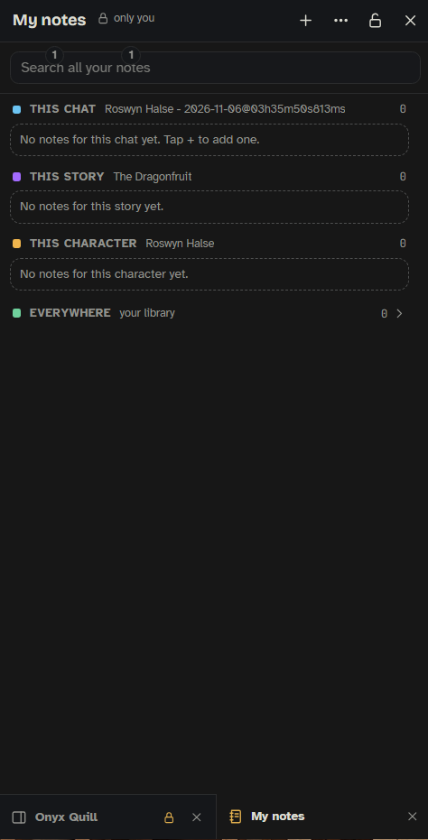

My notes is a place for your own notes: OOC prompts you reuse, plot notes, names you made up, anything you want at hand while you write. **They are never sent to any AI**, wherever they show. Open it with the **My notes** button on [[The Bar]]; press it again to close.

This is not the same as Mero's notes (which steer the writer, see [[Mero]]) or SillyTavern's author's notebook (which the writer gets). My notes is only for you.

## Opening and closing

- **On a PC** it is one of Onyx Quill's panels and takes the same place and size as the side panel on its side. Open panels get tabs at the bottom of their side; panels on the same side take turns (see [[Side Panel]]). Pick the side with ⋯ → **Move to the left** / **Move to the right**, by right-clicking the lock in its header, or by dragging its tab. The side is remembered.
- **On a phone** it covers the screen, and there is no lock.
- **The lock** (in the header, lit when locked). Unlocked, a click into the chat closes it; a click in the other Onyx Quill panels doesn't. Locked, it stays open whatever you do (other chats, a reload) until you close it with the notes button or ✕. The button on the bar opens it unlocked; right-click the button while it is open to lock or unlock it. Closing it clears the lock.
- SillyTavern's own panels (AI response configuration, characters …) open over it.
- When you open it again, it comes back to the note you had open, or to the list.

Don't want it? **Settings › Interface › The bar › My notes** switches the button off. Your notes stay saved and come back when you switch it on again.

## Where a note shows

Every note shows in one place:

| Shows in | Where you see it |
|---|---|
| **This chat** | only in this chat |
| **This story** | every chat on the same storyboard (see [[Storyboards]]), so all its runs share it (a renamed board keeps its notes) |
| **This character** | every chat with that character |
| **Everywhere** | every chat: your library, for example the OOC prompts you use all the time |

The window lists the notes for where you are first: this chat, this story, this character. Your library (**Everywhere**) is folded underneath; tap its count to open it (it stays the way you left it). Pinned notes (★) show even while it is folded. Notes from other chats, stories and characters stay out of sight until you search.

## Working with a note

- **+** makes a new note. It starts in **This chat** (or **Everywhere** when no chat is open). A note left completely empty is not kept.
- Tap a card to open it. At the bottom, **Shows in** moves it to another place in one tap. A note from somewhere else (found by search) says where it lives; pick a place to move it here.
- The note shows formatted while you write. **B**, **I**, **H** and **•** make text bold, italic, a heading or a list; they light up for what is on where the cursor is. Behind the scenes the note is kept with SillyTavern's own marks (`**bold**`, `*italic*`, `### heading`, `- list`), so a note put in your reply comes out formatted in the chat. Pasted text comes in plain.
- **★** pins it to the top.
- **Put in reply box** (the arrow on a card) drops the note into SillyTavern's message box. If you already typed something, it goes at the end on its own line. On a phone the window closes so you see the box.
- **Copy** copies the text.
- **Delete** asks for a second tap (**Tap again to delete**); the notice that follows has **Undo**.
- **Search all your notes** looks through every note, also the hidden ones, and says where each one lives.

## ⋯ More

- **Bring over Notebook notes**: lists the pages of SillyTavern's Notebook extension. Tick the ones to copy and pick where each shows (Everywhere is preset). "This chat", "This story" and "This character" mean the chat open now, so for plot pages open a chat of that story first. The Notebook keeps its own copy. Bold, italic, headings and lists come along; colors and fonts do not.
- **Move to the left / right** (PC).
- **Sort**: newest first, or A to Z.

## Where they are kept

In one small file on the SillyTavern server, `onyx-quill-my-notes.json` in your user files (not in the settings), so they follow you to other devices. It is read fresh each time the window opens. If it can't be read, the window says so and changes nothing, so a bad read never empties your notes.

See also: [[The Bar]], [[Side Panel]], [[Mero]].
