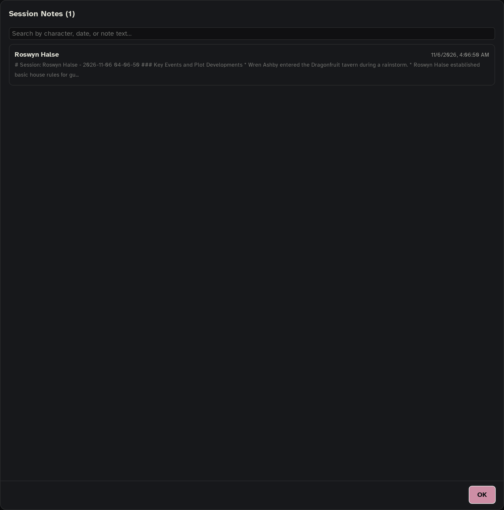
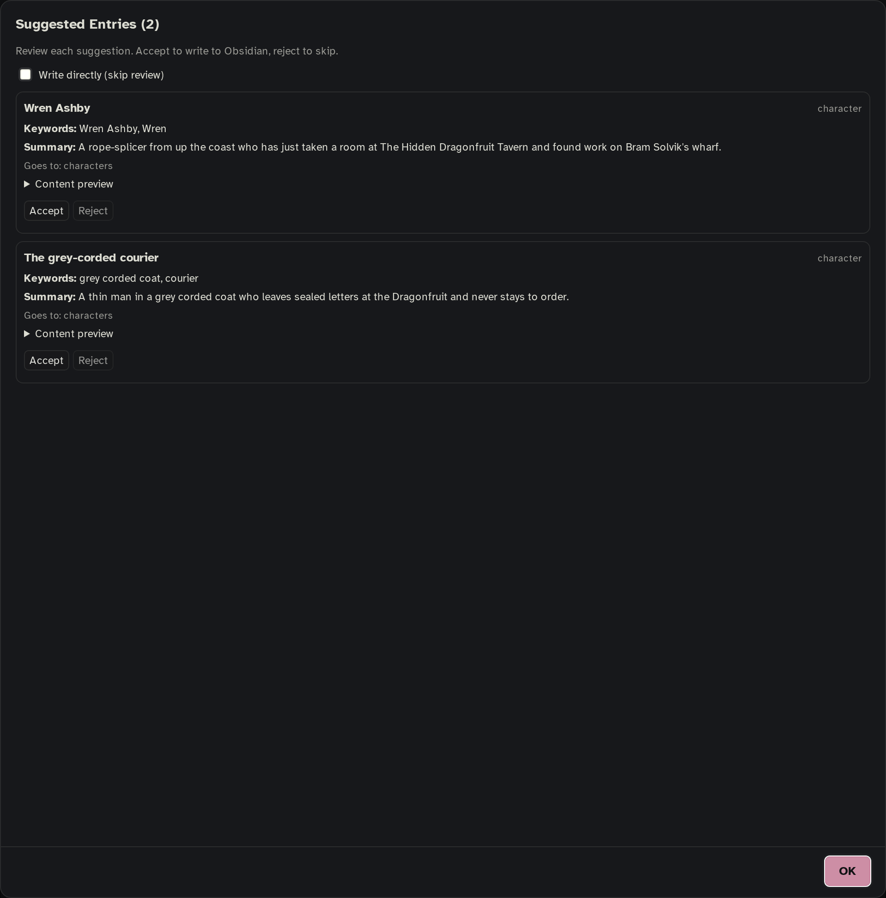

Besides AI search and Mero ☆, Onyx Quill has a few smaller AI helpers that write things for you: the **Scribe** writes session notes into your vault, **New lore** suggests entries for things the chat mentions but your vault lacks, **Write summaries** fills in missing entry summaries, and **Optimize keywords** suggests better keywords for an entry. There is also a chat range summarizer. Each one runs only when you turn it on or press its button.

Each helper has its own row in **Settings › AI & connections**, so you can give it its own model: **Scribe**, **New lore**, **AI notepad** and **Optimize keywords**. A row set to **Same as AI search** uses AI search's connection. Scribe and New lore can also use **SillyTavern's own connection** (the model you chat with). Their prompts are in **Settings › Prompts**.

Two other helpers live elsewhere: **✓ Fix spelling** for your own messages is on [[The Bar]], and the AI's private notes are on [[AI Notepad]]. **Review the vault with Mero**, ✎ Rewrite and the slop guard belong to [[Mero]].

## Scribe: session notes

The Scribe summarizes the recent chat into a note in your Obsidian vault: key events, relationship shifts, new information, and changes like injuries, places and items. Each note builds on the one before it, so notes don't repeat each other.

**Write one now:** press **Scribe** in the [[Side Panel]] header, or type `/oq-scribe`. Add a focus to steer it: `/oq-scribe What happened at the harbor?`

**Write them by themselves:** in **Settings › Story & memory › Scribe**, set **Session notes** to every N messages (1 to 50). 0 means off, which is how it starts.

What a session note looks like in your vault:

- It goes into the **Folder** from the same settings card (`Sessions` at first). If that folder has a subfolder for this chat's run (its name starts with the run letter and names the character), the note goes there instead.
- Its name is the character's name with the date and time.
- It is tagged with your lore tag and `lorebook-session`, so it is a lore entry like any other. The Scribe also writes a few keywords and a one-line summary for it, so a later reply can find the session when it comes up again.

**Browse past notes:** the side panel's **⋯ › Scribe history**, or `/oq-scribe-history`, lists every note in the Scribe's folder, newest first, with a search box.

**Let AI search read them:** **Settings › Lore selection › AI search › Give it the session notes** (behind **More**) sends the Scribe's latest note to AI search as extra story background. That helps it pick entries for threads that started long ago, beyond the messages it reads. It needs at least one session note written in this chat.

### Scribe settings

In **Settings › Story & memory › Scribe**:

| Setting | Default | What it does |
|---|---|---|
| **Session notes** | 0 (off) | Write a note every N messages. |
| **Folder** | Sessions | Where the notes go. |
| **Messages it reads** (behind **More**) | 20 | How many recent messages each note covers (5 to 100). |
| **Write into the vault** (behind **More**) | your first enabled vault | With more than one vault: which one gets the notes. |

The Scribe's answer length (1,024 tokens at first) and time limit (60 seconds) are on its row in **Settings › AI & connections**.

## New lore: entry ideas from the chat

New lore reads the recent chat, compares it with your entries, and suggests new ones for characters, places, things and ideas that have no entry yet. Each suggestion comes with a title, a kind, keywords, a summary and the text.

**Ask now:** press **New lore** in the side panel header, or type `/oq-newlore`.

**Let it notice by itself:** in **Settings › Story & memory › New entries**, set **Notice lore worth writing** to every N messages (3 to 50). 0 means off, which is how it starts.

The suggestions open in a review window. Each card shows where it will go; **Accept** writes that entry into your vault, **Reject** skips it. **Write directly (skip review)** at the top writes the whole batch next time without asking.

### Where new entries go

In **Settings › Story & memory › New entries**:

| Setting | Default | What it does |
|---|---|---|
| **Notice lore worth writing** | 0 (off) | Suggest entries every N messages. |
| **Where they go** | by what they're about | **by what they're about**: story entries about the run go into the run's folder, everything else into the character's base folder. **always the Target folder**: every one into the Target folder. |
| **Target folder** | empty | Used when a chat has no folders yet, or always (see above). Empty means the top of the vault. |
| **Mark them** | on | Adds `made_by: New lore`, `from` (the chat and message) and the `made-by-new-lore` tag. The date is always written. (Entries Mero writes get `made-by-mero`.) |
| **Write into the vault** (behind **More**) | your first enabled vault | With more than one vault: which one gets them. |
| **Write them straight in** (behind **More**) | off | Off: you review each one first. On: they are written without the review window. |

The same placement rule is used by **Write a new entry…** in the bar's 📖 menu.

## Write summaries

AI search reads each entry's `summary` to decide whether it fits the scene, so entries without one are harder to pick well. **Write summaries** has the AI write a one-sentence summary for entries that have none: when the entry should be picked, without giving away the secrets it guards.

- **For the whole vault:** the side panel's **⋯ › Write missing summaries**, or `/oq-summarize`.
- **For some entries:** in the side panel's **Lore › All entries**, press **Select**, pick the entries, then **Write summaries**.

Each summary opens in its own window before anything is written. Edit it if you like; **OK** writes it into the entry, **Cancel** skips that entry, **Abort remaining** stops the rest. It uses the **Optimize keywords** connection. This is useful after importing World Info.

## Optimize keywords

The AI reads an entry (its title, current keywords and text) and suggests a better set of keywords: synonyms, names, phrases that would come up in a scene. The window shows the current and the suggested keywords side by side, with the AI's reasoning. **Accept & Write** replaces the entry's keywords with the suggested ones; **Cancel** changes nothing.

- **For one entry:** `/oq-optimize-keys <entry name>`, or tap the entry in **Lore › All entries** (or **New**) and press **Optimize keywords**.
- **For several:** **Select** them in **All entries**, then **Optimize keywords**. Each entry gets its own AI call and its own review window, one after the other. Close the progress notice to stop the batch.

**Settings › Lore selection › Writing helpers › Optimize keywords** tells the AI how your lore is matched: **keywords only** (it should pick precise keys) or **keywords, then AI** (it may pick broader keys, since AI search refines them). Both ask the AI.

## Summarize part of the chat

`/oq-summarize-range` summarizes a stretch of messages, hides the originals from the AI, and puts the summary in their place as a message named "Onyx Quill Summary". Use it to shorten a long chat without losing what happened.

- `/oq-summarize-range 5-15` summarizes messages 5 to 15. `10-` means from 10 to the end, `-8` the last 8 messages, `7` just one.
- The notice shows the summary's ID. `/oq-summarize-rollback <ID>` undoes that one; `/oq-summarize-rollback` (or `all`) undoes every summary in the chat. The hidden messages come back as they were.

It uses the Scribe's connection.

See also: [[Side Panel]], [[AI Notepad]], [[How Lore Gets Picked]], [[Settings Reference]], [[Slash Commands]].
