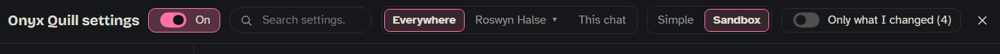

Every row in Onyx Quill's settings window, in the order the window shows it: the label, its default, and what it does. Rows marked **(More)** sit behind a card's **More** button and are hidden in **Simple**. Rows marked "shown when…" appear only while another setting makes them matter. Board, tracker, Cast and World settings are not here: they live on the board (see [[Storyboards]], [[Cast]] and [[World]]).

## Opening the settings

- The bar's 📖 menu → **Setup and settings** (see [[The Bar]]).
- The side panel's ⋯ menu → **Settings** (see [[Side Panel]]).
- SillyTavern's Extensions panel → Onyx Quill → **Open Onyx Quill Settings**. The **Enable Onyx Quill** checkbox there is the same switch as **On / Off everywhere** in the window.

## The window

The header holds, from left to right:

- **On / Off everywhere**: Onyx Quill's main switch. Off, Onyx Quill sends nothing anywhere until you switch it on again. It is off when first installed.
- **Search settings…**: finds a row by its label, its explanation, its card or section, or the name it had in DeepLore. A hit that is behind **More** switches the window to **Sandbox** so you can see it.
- **Everywhere · a character ▾ · This chat**: whose settings you change. **Everywhere** is the whole window. The character button opens a list of every character; it shows only what can differ for that character (see [Per character](#per-character)). **This chat** works only while a chat is open and shows only what can differ in it (see [This chat](#this-chat)). For lore budgets the most specific wins: this chat, then its character, then Everywhere. Folders add up: a chat reads its character's base folders, its run's and its own together.
- **Simple · Sandbox** (only on Everywhere): Simple hides the rarely used rows (the **(More)** rows below). Sandbox, the default, shows each card's **More (N)** button. The window remembers your choice.
- **Only what I changed (N)** (only on Everywhere): shows only rows that differ from their defaults. Every changed row has a **Reset** link that puts back its default.

The sections on the left are grouped as **Lore** (Vault, Filters, Lore selection, Budget & variety, Where it goes), **AI** (AI & connections, Prompts, Mero), **Story** (Story & memory) and **Look** (Interface, Advanced). Each section shows how many of its rows you changed. Inside a section the first card is open and the others are folded with a one-line summary. On a phone you see the section list first: tap a section to open it, and **← All settings** to go back.

## Vault

Where your lore lives and how Onyx Quill reaches it.

### Vaults

Each vault is one line with its address, port, whether it uses HTTPS, an on/off switch and **Edit**. **Edit** opens:

- **Name**: must match your Obsidian vault's name exactly. Renaming a vault asks first: its entries' cooldowns, pins, blocks and stats start fresh (the old ones stay under the old name). The entries themselves don't change.
- **Address** (default `127.0.0.1`) and **Port** (default `27123`, or `27124` with HTTPS).
- **API key**: from Obsidian's Local REST API plugin.
- **HTTPS**: with a **Trust its certificate** link that opens Obsidian's address so your browser can trust it. HTTP is easier.
- **Test** and **Remove**. Removing asks first: Onyx Quill stops reading that vault, and your files in Obsidian are not touched. The last vault can't be removed; add another one first.

Below the list: **Add a vault**, **Scan for vaults** (looks for Obsidian vaults on this computer) and **Test all** (tests every vault that is on). When a test fails, **How to fix** explains what to check.

| Setting | Default | What it does |
|---|---|---|
| **When two vaults have the same entry** | keep both | What happens when two vaults have an entry with the same title: keep both · first vault wins · last vault wins · merge (combine keywords). |

### Reading

| Setting | Default | What it does |
|---|---|---|
| **Re-read the vault every** | 0 | Seconds between automatic re-reads of the vault (up to 3600). 0 = only when you ask. |
| **Tell me what changed** | on | A notice after a re-read finds changes. |
| **Re-read now** | — | Button **Re-read**: reads the whole vault again now and says how many entries it found. |
| **Rebuild the index** (More) | after a time | When Onyx Quill reads its saved copy of your vault fresh: after a time · every N replies · only by hand. |
| **Keep the index for** (More) | 300 | Seconds. Used by "after a time". |
| **Every N replies** (More) | 10 | Used by "every N replies" (1–100). |

### Tags

The tags a note carries decide what it is. A changed tag takes effect after the vault is read again (Onyx Quill does that by itself). An empty box goes back to the default.

| Setting | Default | What it does |
|---|---|---|
| **Lore tag** | `lorebook` | Notes with this tag are lore. Notes without it are ignored. |
| **Always-send tag** | `lorebook-always` | Sent with every reply, whatever the chat says. Use it sparingly: it costs budget every reply. |
| **Never-send tag** (More) | `lorebook-never` | Notes with this tag are never sent. |
| **Seed tag** (More) | `lorebook-seed` | Sent quietly in the background while a chat is new: AI search reads these notes as story background when it picks lore. They only matter when AI search is on. |
| **Starter tag** (More) | `lorebook-bootstrap` | Sent openly while a chat is new; after that they are picked like any other entry. |
| **Secrets-for-Mero tag** (More) | `lorebook-guide` | Notes with this tag are for Mero ☆ only, not lore. She reads them in her talks and pitches (only those in the chat's folders). The writing AI never gets them. This is not the board's 🧭 guidance, which does go to the writer. See [[Mero]]. |
| **A chat counts as new for** (More) | 3 | Messages (1–20). Seed and starter notes work while the chat is this short. |

### Files

| Setting | Default | What it does |
|---|---|---|
| **Field definitions file** | `Onyx Quill/field-definitions.yaml` | Where in your vault the filter fields are defined (see [[Custom Fields]]). Settings that came over from DeepLore keep `DeepLore/field-definitions.yaml`. |
| **Prompts folder** | `Onyx Quill/prompts/` | Where in your vault prompt files go when you export them from **Prompts** (settings that came over from DeepLore keep `DeepLore/prompts/`). A path that can't be used falls back to the default. |

### Cleaning up a run

When you delete the last chat of a run, Onyx Quill asks whether to clean the run up in Obsidian. Nothing is moved or deleted without your yes.

| Setting | Default | What it does |
|---|---|---|
| **A cleaned-up run’s files** | move to the trash folder | move to the trash folder · delete for good. |
| **Trash folder** | `zz Deleted runs` | In your vault. Onyx Quill never reads it. Each cleanup gets its own folder in here: drag a file back out to undo, and empty it in Obsidian. |
| **Clean up a run** | — | Button **Clean up a run…**: pick any run your vault has stamps for, also runs whose chats were deleted earlier. |

## Filters

Which lore each character, run and chat reads. This section is a page of its own, not rows:

- **Open now** (while a chat is open): the character, the run letter and the chat, the folders it reads, whether Onyx Quill is on and why, its board, and where new entries go. Buttons: **Edit** the character, and **This chat only…** (opens the [This chat](#this-chat) scope).
- **Find a character…** and **Rescan cards** (reads SillyTavern's character list again).
- The characters that use Onyx Quill, each with its base folders and runs. Click one to open it: **Onyx Quill for** the character (on means "follow its folders"; with no folders it stays off), **Base folders** with **Edit**, **Run A adds** (one line per run) with **Edit**, and its **Board**.
- **Not using Onyx Quill**: characters with no folders yet or switched off. Tap a name to give it folders, or to switch it back on.
- **More**: the filter fields (era, location and so on) and **Edit the filter fields…**, which opens the field editor (see [[Custom Fields]]).

See [[Side Panel]] for the Filters tab, which shows the same thing for the open chat.

## Lore selection

How Onyx Quill finds the lore for a reply. See [[How Lore Gets Picked]].

### Mode

| Setting | Default | What it does |
|---|---|---|
| **How lore is picked** | keywords only | keywords only · keywords, then AI search (keywords make a short list, then AI search picks from it) · AI search only (AI search reads every entry's summary each time). AI search needs a connection in **AI & connections**. |

### Keywords

| Setting | Default | What it does |
|---|---|---|
| **Messages to read** | 4 | How far back keywords are looked for (0–100). Shown when the mode is not "AI search only". |
| **Match the active character** | off | Also picks the entries whose title or keyword is the active character's name. |
| **Loose matching** | off | Also finds entries whose words are close to the chat, not only exact keywords. |
| **How close** | 0.5 | Shown when Loose matching is on. The lowest score that still counts (0.1–2); low = more matches. A preview below shows sample entries, not your vault. |
| **Case sensitive** (More) | off | Keywords must match upper and lower case. Grayed out when AI search alone picks lore. |
| **Whole words only** (More) | off | A keyword must be a whole word, not part of one. Grayed out when AI search alone picks lore. |
| **Entries can call other entries** (More) | 0 | Steps · 0 = off. An entry's text can match more entries, up to this many steps (1–10). Grayed out when AI search alone picks lore. |
| **Count how often a keyword appears** (More) | off | Entries whose keywords come up more often rank higher among equals. Can slow down big vaults. |
| **Higher priority number wins** (More) | off | Off: a lower `priority` number wins (as in Obsidian and World Info). On: a higher number wins. |

### AI search

| Setting | Default | What it does |
|---|---|---|
| **Leave out below** | low (keep all) | How sure AI search must be about an entry: low (keep all) · medium · high. Grayed out when AI search is off. |
| **Messages AI search reads** | 4 | How many recent messages AI search reads (1–100). Grayed out when AI search is off. |
| **Its prompt** | — | Button **Preview**: shows exactly what AI search is sent for this chat. |
| **If AI search fails** (More) | use the keyword picks | When AI search's call fails: use the keyword picks · always-send entries only · starter entries only · send no lore. |
| **If AI search picks nothing** (More) | always-send entries only | always-send entries only · always-send + starter entries · use the keyword picks · send no lore. |
| **AI search reads** (More) | the summary, else the text | What AI search sees of each entry: the summary, else the text · summaries only · the text only. |
| **Entry text it reads, at most** (More) | 600 | Characters (100–1000), only for entries without a summary: AI search then reads the start of the text. Written summaries are sent whole. |
| **Give it the session notes** (More) | off | Scribe's latest session notes go to AI search too. |
| **Your fields it sees** (More) | empty | A comma list of your own fields AI search sees for each entry. Empty = all of them. |
| **Sort by category first** (More) | off | An extra AI call that narrows a big list by category before AI search picks. |
| **How much it trims** (More) | 0.8 | 0 keeps all … 0.8 trims most. Grayed out when Sort by category first is off. |

### Writing helpers

| Setting | Default | What it does |
|---|---|---|
| **Start the writer’s reply for it** | off | Puts an opening into the writer's reply so it doesn't start with "Certainly, here's…": off · Claude only · every provider. Some providers ignore it. |
| **The opening text** | empty | The words the reply starts with. Empty = none. Grayed out when the prefill is off. |
| **Optimize keywords** | keywords only | Tells **Optimize keywords** how your lore is picked: keywords only (precise keywords) · keywords, then AI (broader keywords, the AI refines). |

## Budget & variety

How much lore goes with each reply, and not the same entries every reply. Set here for Everywhere; a character or a chat can set its own (see [Per character](#per-character) and [This chat](#this-chat)).

### Budget

| Setting | Default | What it does |
|---|---|---|
| **Entries per reply** | 10 | The most entries sent with one reply (1–100). Grayed out when No limit on entries is on. |
| **No limit on entries** | off | Big vaults may feel slower. |
| **Lore budget** | 3072 | Tokens per reply (100–100000). Entries are taken by priority until the budget is used up. Grayed out when No limit on tokens is on. |
| **No limit on tokens** | off | |
| **This chat · a character** | — | Says whether the open chat or any character has its own budget, with buttons to go there. |

### Variety

| Setting | Default | What it does |
|---|---|---|
| **Give others a turn** | off | An entry sent many times in a row steps back; one skipped a long time gets a boost. |
| **Rest after sending** | 0 | Replies (0–50). An entry waits this many replies before it can be sent again. Always-send entries don't rest. |
| **Bring one back after** (More) | 5 | Replies skipped (2–20) before an entry gets a boost. Grayed out when Give others a turn is off. |
| **Hold one back after** (More) | 2 | Times in a row (2–10) before an entry steps back. Grayed out when Give others a turn is off. |

## Where it goes

Where Onyx Quill's parts go in the prompt. The positions are: before the main prompt · after the main prompt · in the chat. "In the chat" adds a **Depth** (how many messages from the bottom) and **As** (system · user · assistant).

### How

| Setting | Default | What it does |
|---|---|---|
| **Place Onyx Quill’s parts** | by these settings | by these settings · in the prompt list. "In the prompt list": drag each part where you want it in SillyTavern's prompt list; the positions below then step aside (grayed out). |
| **Let World Info see Onyx Quill’s lore** | off | SillyTavern's World Info keyword scan also reads the lore Onyx Quill sends, so it can trigger World Info entries. |

### Lore entries

| Setting | Default | What it does |
|---|---|---|
| **Position** | in the chat | Where the lore goes. |
| **Depth** | 4 | Shown when the position is "in the chat". |
| **As** | system | Shown when the position is "in the chat". |
| **How each entry is written** (More) | `<{{title}}>` / `{{content}}` / `</{{title}}>` on three lines | The wrapper around each entry. `{{title}}` and `{{content}}` are filled in. |

### Story state and notes

| Setting | Default | What it does |
|---|---|---|
| **Story trackers block** | in the chat | Where the story's trackers, the board and the Cast are told to the writer. |
| **Its depth** | 4 | Shown when the block is "in the chat". |
| **As** | system | Shown when the block is "in the chat". |
| **Author’s notebook** | in the chat | Where your notebook for the chat goes (see [Story & memory](#notebook-and-notepad)). |
| **Its depth** | 4 | Shown when the notebook is "in the chat". |
| **As** | system | Shown when the notebook is "in the chat". |
| **AI notepad** (More) | in the chat | Where the writer's own notes go back to it (see [[AI Notepad]]). |
| **Its depth** (More) | 4 | Shown when the notepad is "in the chat". |
| **As** (More) | system | Shown when the notepad is "in the chat". |

## AI & connections

Which AI does which job. This section is one table, one row per job, with the connection, when it runs, and **Answer up to** (the most the AI may answer, in tokens; the prompt comes on top). Connections are SillyTavern connection profiles: make one in SillyTavern's API Connections (the plug icon) → Connection Profile. Until you have one, the section says so. Once AI search has run, a line shows how often it ran this session and about how many tokens each call used.

| Job | What it does | Connection choices | Default connection | Answer up to | Time limit |
|---|---|---|---|---|---|
| **AI search** | picks the lore for a reply | a profile | pick a profile | 1024 | 20 s |
| **Story helper** | moves trackers; the Cast's director | a profile | pick a profile | 400 | 20 s |
| **Mero ☆** | talks, pitches, entry ideas | a profile | pick a profile | 1500 | 120 s |
| **World** | chatter, news, messages, rumors | a profile | the story helper's, until you pick one | 1500 | 60 s |
| **Scribe** | session notes | Same as AI search · SillyTavern’s own connection · a profile | Same as AI search | 1024 | 60 s |
| **New lore** | notices lore worth writing | Same as AI search · SillyTavern’s own connection · a profile | Same as AI search | 2048 | 30 s |
| **AI notepad** | keeps notes from replies (extract) | Same as AI search · a profile | Same as AI search | 1024 | 30 s |
| **Optimize keywords** | better keys for an entry | Same as AI search · a profile | Same as AI search | 1024 | 30 s |

"Same as AI search" uses AI search's connection. When you change AI search's connection, a notice names the jobs that follow it. A job set up with the old custom proxy shows **Custom proxy (old)** until you pick a profile.

The **Runs** column says when each job works with today's settings: AI search "every reply" or "off (keywords only)", Scribe and New lore "every N messages" or "off", the AI notepad "every reply" (extract), "not used (tags)" or "off", Mero ☆ "when you ask", plus "checks the lore every few replies" as a Part-timer or "after every reply" as a Full-timer, Optimize keywords "when you ask", the World "in stories with the world layer on".

**Fine print** (folded) has, for each job:

- **Model**: a different model on the same connection. Empty = the profile's model (for "Same as AI search": AI search's). Grayed out for SillyTavern's own connection.
- **Answer up to**: tokens.
- **Time limit**: seconds.
- **Test**: sends a one-line test message through this connection.

And one switch for all jobs:

| Setting | Default | What it does |
|---|---|---|
| **Put the system prompt into the user message** | off | For providers that have no system role. |

## Prompts

Every prompt in one place, with its size. This section is a page of its own:

**AI jobs** lists each built-in prompt with its size in tokens (or "built in") and **Edit**; an edited one shows an **edited** badge and a **Revert** button (back to the built-in prompt).

| Prompt | What it is for |
|---|---|
| **AI search** | picks lore |
| **Scribe** | session notes |
| **New lore** | entry ideas |
| **Optimize keywords** | better keys |
| **AI notepad: tags** | how the writer marks notes |
| **AI notepad: extract** | the helper that reads each reply |

**Edit** opens the prompt in a box (the built-in one while it is unchanged). There you can **Save as preset…**, pick one of your **Saved presets…**, **Remove a preset…**, or put **Back to the built-in** in the box. Nothing changes until **Save**. Saved unchanged, it stays the built-in prompt.

**+ Your own prompt** adds a piece of your own to every reply's prompt. It has a **Name**, **Where it goes** (before the main prompt · after the main prompt · in the chat, with **Depth** and **As** for "in the chat") and the text, with a size count. Your own prompts are listed as **Your own: "name"** with **Edit**; an open one has **Remove**.

**Prompt files in your vault** (folded, shows the prompts folder) lets you edit prompts as files in Obsidian: **Export to vault** (writes every prompt as a file into the prompts folder), **Reload** (reads the prompt files again) and **Reset all** (deletes every prompt file from the vault folder; asks first).

## Mero

Your co-writer: who she is and how she helps. Her AI is picked in **AI & connections**. See [[Mero]].

### Who she is

| Setting | Default | What it does |
|---|---|---|
| **In your words** | her first description | Button **Edit**: who Mero ☆ is, in your words. **Back to the first draft** puts her first description back in the box; nothing changes until **Save**. |
| **She calls you** | empty | The name Mero uses for you, also on your messages to her. Empty: no name; she just says "you". Up to 40 characters. |

### Her job

| Setting | Default | What it does |
|---|---|---|
| **How much she does** | Part-timer | Her lore upkeep, how often she checks your entries against the story: Off duty (never) · Freelancer (only when you ask) · Part-timer (after every 5 new replies) · Full-timer (after every reply). |
| **Needs my sign-off** | on | On: nothing is written without your yes. Off: she writes changes herself, each with an Undo. Switching it off asks first. |
| **Searches the web** | on | When she needs a real-world fact. Uses the search service set up in SillyTavern's Web Search extension. Your lore always wins over the web. |

### How she talks

| Setting | Default | What it does |
|---|---|---|
| **Chattiness** | Chatty | Quiet · Chatty · Very chatty · Custom. Quiet: talks a little, no glow. Chatty: talks some, glows at big moments. Very chatty: talks a lot, brings things up herself, glows at quiet threads too. |
| **Custom: how much she talks** | some | Shown with Custom: a little · some · a lot. |
| **Custom: brings things up herself** | off | Shown with Custom. |
| **Custom: the glow** | big moments | Shown with Custom. Her 💬 lights up after a big moment on the board, an invitation to talk about it. Costs nothing until you click it. off · big moments · + quiet threads. |
| **She reads the latest** | 12 | Replies of the story she reads (2–40). |
| **Her settings** | — | Button **Reset**: every Mero setting back to default, including **She calls you** and **Who drives the story**. Only who she is (her description) stays. Asks first. |

### What the story writer is told

| Setting | Default | What it does |
|---|---|---|
| **Who drives the story** | balanced | Told to the AI that writes the story replies, not to Mero: follow my lead · mostly follows · balanced · brings events · takes the wheel. Balanced tells it nothing. |

## Story & memory

What Onyx Quill writes down, and the story tools.

### Trackers and board

Tracker, board and Cast settings live on the board.

| Setting | Default | What it does |
|---|---|---|
| **Trackers, board, Cast** | — | Button **This chat…**: opens the [This chat](#this-chat) scope (its board, and Onyx Quill on or off). |
| **The board** | — | Button **Open**: opens the board window (see [[Storyboards]]). |

### New entries

What Onyx Quill does when the chat brings up something your vault has no entry for. See [[Scribe and AI Helpers]].

| Setting | Default | What it does |
|---|---|---|
| **Notice lore worth writing** | 0 | Every N messages (3–50) · 0 = off. The **New lore** job reads the chat and suggests new entries. |
| **Where they go** | by what they’re about | by what they're about (about the run → the run's folder; about the character → the character's base folder) · always the Target folder. |
| **Target folder** | empty | Used when a chat has no folders yet (or always, with the choice above). Empty = the top of the vault. |
| **Mark them** | on | Writes `made_by: New lore`, `from` (chat and message) and the `made-by-new-lore` tag into new entries. The date is always written. |
| **Write into the vault** (More) | the primary vault | Which vault new entries go to (with more than one). |
| **Write them straight in** (More) | off | Off: you review each one first. |

### Scribe

| Setting | Default | What it does |
|---|---|---|
| **Session notes** | 0 | Every N messages (1–50) · 0 = off. Scribe writes a summary of the session as a note in your vault. |
| **Folder** | `Sessions` | Where the session notes go. |
| **Messages it reads** (More) | 20 | 5–100. |
| **Write into the vault** (More) | the primary vault | Which vault the notes go to (with more than one). |

### Notebook and notepad

| Setting | Default | What it does |
|---|---|---|
| **Author’s notebook** | off | Your own notes for a chat, sent to the writer with every reply (where **Where it goes** says). |
| **AI notepad** | off | The writer keeps its own notes, which go back to it with later replies. See [[AI Notepad]]. |
| **How it gets its notes** | tags | tags: the writer adds them to its reply, no extra call · extract: a helper reads each reply (the **AI notepad** job). |
| **Notes it keeps** (More) | 50 | 0 = no limit (up to 1000). The oldest drop first. |
| **Count as the same note from** (More) | 0.85 | 0.1 … 1: how alike two notes must be to count as the same when you clean up duplicates. |

### Importing World Info

| Setting | Default | What it does |
|---|---|---|
| **Shrink imported entries** | off | Shortens imported entries to save tokens. |
| **Example messages** | add them under a subheading | What happens to example-message entries in a World Info book: add them under a subheading · skip them. |

## Interface

Colors, the bar, notices, removing things, and the graph.

### Look

| Setting | Default | What it does |
|---|---|---|
| **Colors** | follow SillyTavern | follow SillyTavern (your own colors too) · light · dark. |
| **Accent color** | Mero pink | Onyx Quill's own color: Mero, the active tab, main buttons, what is selected. Ready colors: Mero pink, coral, orange, teal, blue, lavender, purple, or a color of your own. It stays readable on any theme. |

### The bar

See [[The Bar]].

| Setting | Default | What it does |
|---|---|---|
| **Show the Onyx Quill bar** | on | The bar above the message box. |
| **My notes** | on | A notes button on the bar: your own notes, never sent to the AI. See [[My Notes]]. |
| **Button: Re-evaluate and swipe** | on | On the bar, after the divider (on a phone in ⋯). |
| **Button: Guided swipe** | on | Swipe the newest reply with a direction. |
| **Button: Fix spelling** | on | Corrects typos in your message box, with Undo. |
| **Button: Simple send** | on | Post as your message, no reply. |
| **Button: Keep as a draft** | on | Put what you typed aside, and back. |
| **Hide SillyTavern’s Quick Reply row** | on | While you have Quick Replies starred on the bar. |
| **Floating icon drawer** | off | Other extensions' floating icons wait in a small tab on the bar instead of over your chat: off · phone only · always. |
| **Icons in the drawer** | — | Button **Choose…**: each floating icon on this screen, with a switch. Grayed out while the drawer is off. |

### Notices

| Setting | Default | What it does |
|---|---|---|
| **Pop-ups** | one per message | How story changes are announced: one per message (a summary) · every change. |
| **Ask before removing** | off | On: everything asks first. Off: small things go at once with Undo; big ones ask. The same switch as the board's Edit › Ask before removing. |

### Graph

The entry graph (side panel ⋯ → **Graph**, or `/oq-graph`).

| Setting | Default | What it does |
|---|---|---|
| **Spacing** | normal | tight · normal · loose. Sets the physics under More for you. |
| **Color by** | type | type · priority · connections · frequency · community. |
| **Labels** | on | Entry names on the graph. |
| **Repulsion** (More) | 0.3 | How strongly entries push apart (0.1–5). |
| **Gravity** (More) | 11 | How strongly entries pull to the center (0.1–20). |
| **Damping** (More) | 0.5 | How quickly the movement settles (0.3–0.98). |
| **Hover dim distance** (More) | 3 | How many links away stay lit when you hover an entry (0–15). |
| **Focus tree depth** (More) | 2 | How many links deep the focus view goes (1–15). |
| **Hover falloff** (More) | 0.55 | How fast the light fades per link (0.3–0.85). |
| **Edge filter alpha** (More) | 0.05 | Lower shows fewer, stronger links (0.01–0.5). |

## Advanced

For troubleshooting. See [[Diagnostics]] and [[Troubleshooting]].

### Troubleshooting

| Setting | Default | What it does |
|---|---|---|
| **Debug mode** | off | More detail in the browser console. |
| **Diagnostics** | — | Button **Open**: health, recent activity, session stats. |
| **Export diagnostics** | — | Button **Export**: a file to share, with names removed. |
| **The AI pause** | — | Button **Reset**: after repeated AI errors Onyx Quill pauses its AI for a short while; this clears the pause. |
| **Try matching** | — | Button **Open**: replays this chat and shows which entries each message calls up. |
| **Answer length for a vault review** | 0 | Tokens · 0 = Mero's own. The answer length when Mero reviews the lore this story reads (`/oq-review`). |

### Reference

| Setting | Default | What it does |
|---|---|---|
| **Slash commands** | — | Button **Show**: a list of commands; click one to copy it. See [[Slash Commands]]. |
| **Setup wizard** | — | Button **Run**: see [[Setup Wizard]]. |
| **About** | — | Button **Show**: the version, the credit to DeepLore by pixelnull, and links to this wiki and DeepLore. |

### Start over

| Setting | Default | What it does |
|---|---|---|
| **Reset all settings** | — | Button **Reset all**: every section back to the defaults, except Mero's (her settings have their own **Reset** in **Mero**). Asks first. |

**Reset all** keeps: your vault and AI connections (each job's connection, profile and model), your own prompts and edited prompts, saved prompt presets, the opening text for the reply, your words for Fix spelling, starred Quick Replies, your saved draft, character budgets, the graph layout and usage stats. Onyx Quill stays on or off as it is. Your boards, runs, lore, notes and Mero's talks are not settings and are never touched.

## Per character

Pick a character from the character button in the header. The page shows only what can differ for that character; everything else follows Everywhere.

- **Onyx Quill for** the character: on means "read its folders". With no folders it stays off, and the line says so.
- **Base folders**, with **Edit**: the folders every chat with this character reads.
- **Run A adds** (one line per run), with **Edit**: folders only that run's chats add.
- **Board**: the character's default board for new chats (set on the board, or with `/oq-board-character`).
- **Lore budget** and **Entries per reply**: each says the value that counts and where it comes from. **Set** gives the character its own value (0 = no limit); **Reset** follows Everywhere again.

## This chat

Choose **This chat** in the header while a chat is open. Each value says where it comes from.

- **Onyx Quill in this chat**: like the character · always on · off.
- **Base folders** (from the character) and **Run A adds** (from the run), with **Edit**.
- **This chat adds**, with **Change**: folders only this chat adds (the same as `/oq-set-folder`).
- **Board**: the chat's board, with **Open**.
- **Lore budget** and **Entries per reply**: **Set** gives the chat its own value (0 = no limit); **Reset** follows the character or Everywhere again.
- One line per filter field (era, location, …) with its value for this chat and **Set**.

Whether trackers follow the story is switched in the side panel's Story tab (see [[Side Panel]]), not here.
