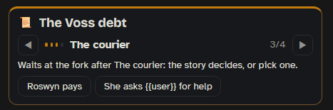
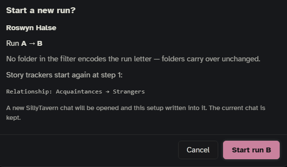

A storyboard is a plan for your story that Onyx Quill follows while you play. It holds **trackers**: where a relationship or a plot stands, what has been found, where the scene is, what day it is, how much someone trusts `{{user}}`, and who your NPCs are. Before each reply, a helper AI reads the newest messages and moves the trackers when the story plainly says so. The writing model is then told where things stand, and vault entries you linked to a step, a place or an item go in only while the story is there.

One board can be used by many chats. Each chat keeps its own place on it.

## What happens on each reply

1. You send a message. Before the reply is written, the **story helper** reads the newest 3 messages and reports what changed: a step reached, a clue found, a new place, a day passing, trust going up. This runs on a normal send only, not on a swipe, regenerate or continue.
2. Every change has to quote the messages word for word, and it has to follow the board's rules (a forward-only tracker never goes back, a step that needs something waits for it, and so on). A change that fails is not applied.
3. Each change that goes through shows a notice with its quote and **Undo**. It is logged at your message, so deleting that message takes it back.
4. Each swipe of the newest reply keeps its own board. A normal swipe starts from the board of the swipe it came from; flipping back to an earlier swipe puts that swipe's board back (its moves, items, places, Cast and its **What this changed** list). Flipping costs no AI call.
5. The writing model gets one short block saying where the story stands, plus the entries that belong to where the story is now.

The story helper is one AI call per reply, on its own connection: **Settings › AI & connections › Story helper**. Without a connection, trackers only move when you move them. To stop the helper in one chat, open the side panel's **Story** tab, ⋯ › **Trackers move** › **Only by hand**.

## Opening the board

- The bar's 📖 menu › **Open the board**.
- The side panel's ⋯ › **Open the board**.
- The **Story** tab › **Timeline** (opens the board on its Timeline).
- The slash command `/oq-board`.

The board opens as a large window over SillyTavern. **Close** (top right) takes you back to the chat. It works on a phone too.

## The board window

**Tabs:** **Board** (the tiles), **Outline** (the same as a list), **Timeline** (this chat's real history: moves, starts, places, items, days, each with "Go to message") and **World** (the [[World]] layer's settings for this board).

**Menus:**

- **File**: New…, Open…, Save, Save as…, Save as and apply to…, Save as template, Apply to…, Delete board….
- **Edit**: Undo, Redo, Rename board…, Rename the selected tile, Duplicate the selected tracker, Move row up / down, Ask before removing, Delete…, Folders this board reads…, Suggest a setup from the folders…, Board settings…, Smart arrange.
- **View**: Board, Outline, Timeline, World, and the window's color themes.
- **Appearance**: Everywhere… or This board….
- **Help**: Keyboard shortcuts, Show tips in the panels, Getting started, Tips, Keyboard & mouse, Slash commands, What's what.
- **Used in N** shows which chats and characters use this board.

**Draft, Save, Discard:** your edits are a draft until you press **Save** (or Ctrl S). Chats keep using the saved board until then.

**The tools row:** **Select**, **Add ▸**, **Remove**, **View ▸**, **Check ▸** (problems on the board, with a count), **Play ▸**, **Mero**, Undo / Redo, and the tile size (**Full**, **Compact**, **Mini**). The search box finds trackers, steps, clues, entries and notes (press `/`).

- **Add ▸** opens a second row: **+ Tracker…**, **+ Step**, **+ Entry**, **+ Connection**, **+ Fork**, **+ Detour**, **+ Note**.
- **View ▸** sets the tile size, opens or closes all drawers, shows connections on hover, all or off, and has **Highlight**, **◎ Focus** (one tile in the middle with what it depends on) and **⇅ Arrange**.
- **Check ▸** steps through what is wrong or worth a look: ⛔ must fix, ⚠️ worth a look, ℹ️ hints.
- **Play ▸** › **Walk the board in story order**: a play-through in a sandbox. Your chats are untouched.
- **Mero** opens [[Mero]] ☆ on the board to help you set it up. When she needs to know something, she asks with question cards: pick an answer or write your own, add details under "Anything to add?", then **Send answers**.

Click a tile to see and edit it in the side panel of the window. The side panel has tabs across the top:

- **Tracker**: the whole tracker, with its steps and settings. Always first.
- **Step** (or **Band**, **Branch**, **Item**, **Place**, **Field**, **Person**, **Detour**): the tile you clicked. Tapping a step opens this tab.
- **Links**: the connections of this tile, then those of the whole tracker (with its "Starts when"), each with **+ Connection into this** and **+ Connection from this**. The count shows how many there are. Links stays open while you click around.
- **⚙**: the board's own settings (the same as **Edit › Board settings…**).

Notes on tiles and connections are for you only and never reach any AI.

## Starting a board

**File › New…** offers an empty board or one of four starter templates. Each is a small working example of what a board can do:

| Template | What it shows |
|---|---|
| **Slow-burn romance** | relationship steps with a fork at the confession, Trust and Attraction meters, one-way flags such as First kiss |
| **Mystery** | an investigation, clues and suspects with their own states, places, one-way pressure flags |
| **Fantasy quest** | a quest with a fork at the trial, a pack with items and gold, a map, day · time of day · weather, a health meter |
| **Slice of life** | dated events on a calendar, becoming family, a mood meter, places around town, shared memories that grow |

Everything in them can be renamed, changed or removed. Templates you make with **File › Save as template** are listed under them.

## Adding a tracker

**Add ▸ › + Tracker…** opens **Add to the board**. First pick what to add, then fill in its name, icon, color and steps (or places, or states).

| Group | Kinds |
|---|---|
| Story lines | **Tracker** (a line of steps: a relationship, a plot, an arc) · **Fork** (an interlude or an ending after a step) |
| Things you collect | **Clues** · **Suspects** · **Inventory** (items with amounts) · **Flags** (yes / no facts) · **Collection** (with your own states) |
| Numbers | **Counter** (a number: money, days) · **Meter** (trust, tension, told as a named band) |
| The world | **Places** (where the scene is) · **State** (time of day, days, weather, due dates) · **Cast** (NPCs with their own cards) |

### Steps, forks and detours

A tracker moves through its steps as the story goes, for example Strangers › Acquaintances › Friends. In its settings you choose whether it **Moves back too**, whether it **May skip steps**, its **Strictness** (what counts as evidence) and when it should ask you first. A tracker can start later, once a connection says so.

- A **fork** after a step splits the story: the story decides which branch is taken, or a 🎲 roll does. After a branch the tracker can go on, go back to a step, or end.
- A **detour** is a side state on a step (for example "Not speaking" while still at Friends). The helper can set it, and you can clear it in the Story tab.
- `/oq-tracker-branch` takes a branch by hand; `/oq-tracker-go` jumps to a step.

### Collections and flags

A collection keeps things with states: a clue goes from hidden to uncovered, a suspect from unknown to suspected. You can let items have amounts (3 × rope), give the collection a purse (money that items cost from), and let **The story can add new items** (a key pocketed, a clue found, added with the quote; you can be asked first). A flag or item can be **One-way**: once it is yes, it never goes back by itself.

An item can also be "there to be found" only in some places or moments, with a connection that makes it findable. Until then the helper cannot take it.

### Counters and meters

A **counter** is a plain number you change by hand. A **meter** is a counter the helper watches: it reports slight, clear or big changes with a quote, and the board turns that into points. You name the bands (for example Wary, Guarded, Open), and the writing model is told the band, never the number. A meter can be **Two-ended** (Rivals ← 0 → Friends) and can drift back to a resting value (**Drifts back**) when nothing happens. Entries linked to a band go in only while the meter is in that band.

### Places

A place tracker follows where the scene is. It can pin the current place's entry while you are there (**Pin the entry of where we are**) and let nearby places come in. Places can sit inside each other. With **Sets Onyx Quill's location filter** on (the default), where the scene is becomes the Location in the Filters tab.

### State and dates

A state tracker keeps time of day, days, weather or any list of values you make. A value that cycles (Morning › Afternoon › Evening › Night) can add a day when it comes round. Its calendar holds dates: your own for every chat, and dates the story adds in one chat ("in two days there is a festival"), if you allow it.

### Cast

A Cast holds your NPCs, each with their own character card. See [[Cast]].

## Connections

Connections tie things together: "starts when Innkeeper Roswyn Halse is in the scene", "needs the key", "the cellar makes the lantern findable". The kinds are **starts when**, **needs**, **needs (an item or money)**, **blocks**, **only one at a time** and **makes it happen**. A connection can have 🎲 odds. Add them with **+ Connection**, or from the side panel's **Links** tab. **View ▸ › ☰ All connections** lists them all.

## Entries on the board

Link vault entries to a step, a fork branch, an item, a meter band, a place or a person with **+ Entry** (or + entry in a tile's drawer). You can link an entry from your vault or write a new one there, and Mero ☆ can draft it. Each link has a kind:

- 📄 **context**: facts for the writing model, there while the story is at that tile. AI search picks it when it fits; 📌 pinned means it always goes in while the tile is active.
- 🧭 **guidance**: how the writer should write the character at that point of the story ("they're married now: they act like this"). It changes by itself as the board moves on, and goes to the writing model as guidance, not as lore. It is not the same as Mero's notes, which are out-of-character notes you keep for as long as you say (see [[Mero]]).
- ⚖️ **judge**: only for the story helper, to know what counts as reaching that step. It never reaches the writing model, wherever it is linked.

A strict step (set on the step or on its tracker) without a ⚖️ judge entry shows a warning under **Check ▸**.

## Board settings

**Edit › Board settings…** (or the side panel's ⚙ tab) holds the settings for the whole board:

- **Folders it reads**: the board never looks outside these, and new entries are saved into them.
- **Mode › While playing**: **Director** (notices and everything visible) or **Immersion** (no notices, spoilers hidden).
- **Steering › Let the writer know the next step**: tells the writing model, gently, where each story line is heading.
- **How often may the AI ask you?**: how often the helper asks before deciding (new items and clues, moves it isn't sure about, suggestions). Whatever it doesn't ask, it decides by itself and logs with Undo.
- **Switched off for**: chats or characters where the board does not run at all.
- **Applied to**: the chats and characters that use it.

## Using a board in chats

- **File › Apply to…** (or `/oq-board My Story`) puts a board on a chat or a character.
- `/oq-board-character My Story` makes it the default for new chats with this character.
- Each chat keeps its own place on the board. The **Timeline** tab shows one chat at a time; pick the chat at the top.
- On the Timeline you can also pause or abandon a tracker for one chat only.

## Starting over: new runs and branches

A **run** is one play-through of a story with a character, marked by a letter: run A, run B and so on. Each run can have its own folders in your vault, so what happened in one play-through (its session notes, the lore that grew from it) never leaks into another.

**New run** (in the [[Side Panel]] header) starts the story fresh in one step:

- It works out the next free letter for this character from your vault, so reopening an old run never hands its letter out twice.
- Before anything happens it shows you the plan: the letter (A → B), which folders are swapped for the new run's, which folders will be created the first time something is written there, and which trackers start again at step 1.
- Then it opens a new chat with the setup carried over, the same board included. The old chat stays as it was.

**Branch here as a new run** turns a branch into its own play-through. Use it from the 📖 menu on any reply, with `/oq-branch-run`, or just branch with SillyTavern's own button: the new chat offers it the first time it opens.

- The new run gets the next letter and the history of the old run up to that point: session notes from before it (the one that covers the branch point is shown unticked, for you to decide), and the lore filed for that run (dated entries from before the point ticked, undated ones for you to pick).
- Everything is **copied**, never moved. The run you branched from stays exactly as it was.
- Nothing is written until you press **Start run B** (with the new letter).
- The trackers go back to where the story stood at that message.

## In the chat

- The side panel's **Story** tab shows your trackers and lets you move them by hand (◀ ▶, or tap a step). It also has **Pause board**, **Timeline** and the **What changed** list with Undo. See [[Side Panel]].
- **Pause board** stops the whole board in this chat until you press **Resume board**: nothing of the board runs there, and the [[World]] layer is gone from that chat too.
- Each message's 📖 menu › **What this changed** shows what the board changed at that message, with Undo.
- **Re-evaluate and swipe** (on [[The Bar]] or the newest reply's 📖 menu) gives the newest reply a fresh look as a new swipe: the board goes back to before that turn, the helper and AI search are asked again, and a new swipe is written. Nothing is lost: the swipe you were on keeps its board, and flipping back to it brings it back.

## What it costs

| What | AI calls |
|---|---|
| The story helper | one call per reply you send (not on swipes, regenerates or continues), while the board has something running |
| Re-evaluate and swipe | one story helper call, a fresh AI search call (when AI search is on), and the new swipe |
| Flipping between swipes | none |
| The Cast's director | one more call per reply, while someone from a Cast is in the scene or someone away could come looking for `{{user}}` (see [[Cast]]) |
| Mero ☆ on the board | only when you ask her |
| Play-through, Check, editing the board | none |

The [[World]] layer has its own costs and is off unless you switch it on.

## Slash commands

`/oq-board`, `/oq-board-off`, `/oq-board-saveas`, `/oq-board-character`, `/oq-board-detach`, `/oq-tracker`, `/oq-tracker-go`, `/oq-tracker-aside`, `/oq-tracker-branch`, `/oq-tracker-run`, `/oq-tracker-next`, `/oq-tracker-back`, `/oq-tracker-remove`, `/oq-tracker-rewind`, `/oq-branch-run` and `/oq-reevaluate`. See [[Slash Commands]].

See also: [[Cast]], [[World]], [[Mero]], [[Side Panel]].
