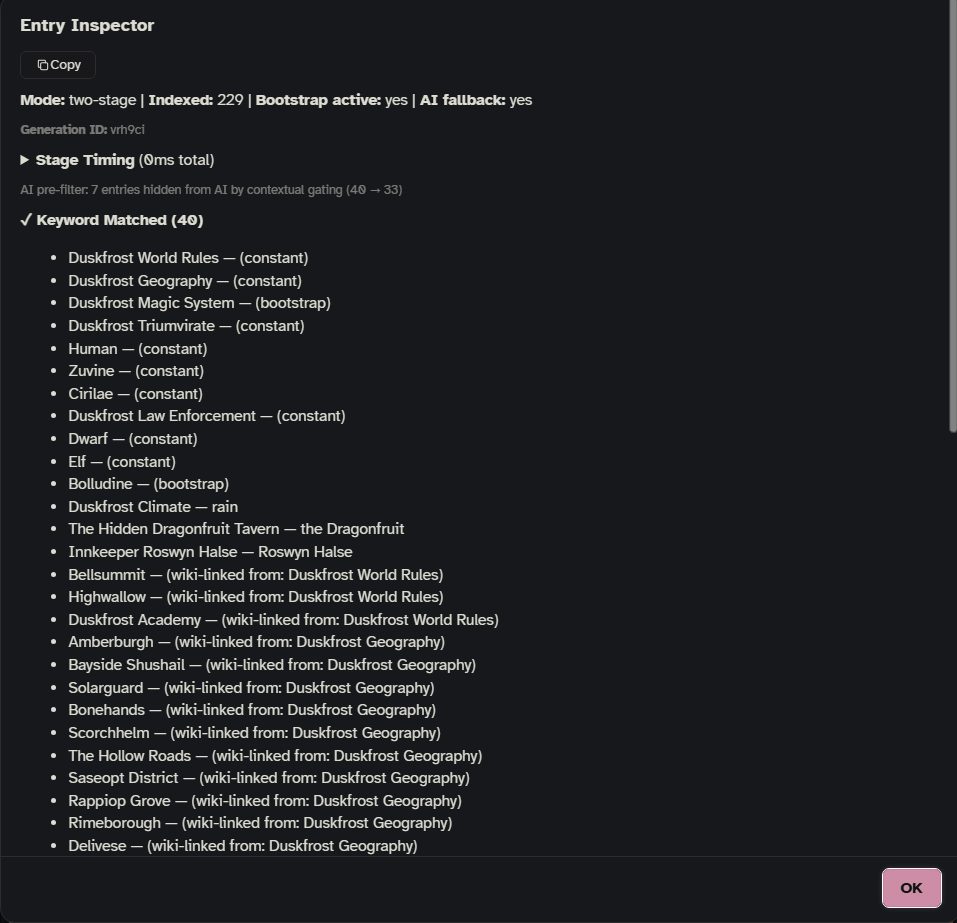

This page is for the curious: what Onyx Quill does each time you send a message, how it keeps a copy of your vault, which AI does which job, what happens when an AI fails, how settings move between versions, and where everything is stored. You don't need any of it to write a story. For the tools that show these steps on a real reply, see [[Diagnostics]].

## What happens on each reply

Every time SillyTavern is about to ask the writing model for a reply (a new message, a swipe, a regenerate, a continue), Onyx Quill runs these steps in this order:

1. **Is Onyx Quill on here?** It can be switched off for one chat or for one character, and a one-on-one chat whose character has no folders anywhere (its own, its run's, the chat's) counts as off. Then nothing is added to the prompt. Group chats follow only their own switch. You see and change this in the side panel's **Filters** tab ("Onyx Quill in this chat"). In a group chat the Filters tab shows a simple on / off switch for that chat (or use `/oq-chat on|off`).
2. **A Cast member's own message?** When someone from the [[Cast]] writes their own message, their prompt takes over this reply.
3. **[OOC: …] brackets** in your message go to [[Mero]] ☆ and are taken out of what the writer sees (your stored message stays as you wrote it). A message that is only `[OOC: …]` starts no story reply.
4. **One at a time.** Only one lore selection runs at once. If one hangs for more than 30 seconds, the next one takes over and a notice suggests checking your AI time limits.
5. **Fresh vault.** If the saved copy of your vault is due for a re-read (see [The vault index](#the-vault-index)), it is read again now.
6. **The story moves.** With a board in the chat ([[Storyboards]]), the Story helper reads the latest messages and moves trackers; then the Cast's director updates who is here and what they plan; then a hidden pitch whose moment came is added. Then the board's own turn runs its triggers and odds (no AI).
7. **The board narrows the lore.** Entries linked to a step other than the current one, to a fork branch not taken, or to an item not found yet are taken out for this reply. Pinned entries stay. The board's current place sets the location filter and is pinned for this reply.
8. **Folders.** The chat reads its character's folders, its run's folders and its own folders together. Everything outside them is out of the running before anything else looks at it.
9. **Picking the lore**, in the mode you chose in **Settings › Lore selection › Mode** (see [Three ways to pick lore](#three-ways-to-pick-lore)): keywords, then AI search, or either alone. Secrets for Mero ☆ (the `lorebook-guide` tag) never reach this step.
10. **Your rules.** Pins and blocks; field filters (era, location, scene, characters present, your own fields); **Rest after sending**; `requires` / `excludes`.
11. **Budget.** Entries are sorted by priority and added until **Entries per reply** or the **Lore budget** is full; the last one that doesn't fit whole is cut at a sentence. The budget can be set for Everywhere, a character or a chat; the most specific wins. Then each entry is written with your template and grouped by where it goes (**Settings › Where it goes**).
12. **The other blocks.** The board's block (where each tracker stands, 🧭 guidance for the current step, what the main character knows from [[World]] messages), your own prompts from **Settings › Prompts**, Mero's notes for the writer, the Author's notebook and the [[AI Notepad]]. These go out on every reply, even when no lore matched.
13. **Into the prompt**, and a record is kept: what went out (for 📖 **Why these entries**), cooldowns and counts, analytics. If the lore takes more than 20% of the model's context, a notice warns you.

After the reply arrives, the jobs that run "after a reply" do their work: the AI notepad (extract mode), Scribe and New lore at their intervals, and the slop guard's count (no AI).

## Three ways to pick lore

**Settings › Lore selection › Mode › How lore is picked**:

- **keywords only** (the default): an entry goes out when one of its keywords is in the last messages (**Messages to read**, 4 by default). No AI call. Refine keys, warmup, chance, cooldowns, cascade links, chain matching (**Entries can call other entries**), loose matching and **Match the active character** all happen in this step.
- **keywords, then AI search**: keywords find the candidates, and entries linked from them by wiki-links join in; then AI search (an AI) reads short descriptions of the candidates plus the recent chat and the board's state, and picks the ones that matter now. One extra AI call per reply.
- **AI search only**: AI search reads descriptions of the whole vault (inside the chat's folders). More thorough, more tokens per call.

**If AI search fails** and **If AI search picks nothing** (**Settings › Lore selection › AI search**, behind More) say what goes out instead: by default, the keyword picks after a failure, and the always-send entries when it picks nothing. **Sort by category first** (off by default) adds one small AI call that narrows a big candidate list (40 or more) by category before AI search reads it.

AI search remembers its last picks. When only new messages came in and they don't mention any entry by name or keyword (a swipe, for example), it reuses them instead of calling the AI again. Editing an older message resets this.

The details of each step are on [[How Lore Gets Picked]].

## The vault index

Onyx Quill reads your notes straight from Obsidian's Local REST API plugin: the browser that shows SillyTavern talks to Obsidian directly. It keeps the result, the index, in memory and saves a copy in the browser's storage. On the next page load it starts from that copy at once and checks Obsidian in the background, so the first reply doesn't wait and a briefly closed Obsidian is no problem.

When it reads again (**Settings › Vault › Reading**):

- **Rebuild the index** (behind More): **after a time** (the default; **Keep the index for** 300 seconds), **every N replies**, or **only by hand**. A due re-read happens when you send a message.
- **Re-read the vault every** N seconds checks for changes in the background (0, the default, means only by hand). **Tell me what changed** shows a notice listing new, removed and changed entries.
- **Re-read now**, or `/oq-refresh`, reads everything again at once.

A re-read fetches every note but only re-parses the ones whose text changed. Notes that can't be read are skipped and listed by `/oq-lint`.

**When Obsidian doesn't answer**, Onyx Quill stops asking that vault for a moment after three failed calls, waiting a little longer each time (2 seconds, up to 15), so a closed Obsidian doesn't slow every reply. Each vault (address and port) has its own pause. The next call that works ends it; **Test** in **Settings › Vault** ends it at once.

For safety, Onyx Quill only sends your API key to addresses on your own computer or network: `localhost`, `127.x`, LAN addresses (`10.x`, `172.16–31.x`, `192.168.x`), private IPv6, and Tailscale names ending in `.ts.net`. Public addresses are refused.

## Connections: which AI does which job

All AI calls go through SillyTavern's **Connection Profiles** (API Connections, the plug icon › Connection Profile). Each job picks its own in **Settings › AI & connections**, so a cheap fast model can pick lore while a stronger one talks with you as Mero ☆.

| Job | What it does | Connection by default | Answer up to | Time limit |
| --- | --- | --- | --- | --- |
| **AI search** | picks the lore for a reply (and **Sort by category first**) | a profile you pick | 1,024 | 20 s |
| **Story helper** | moves trackers; the Cast's director | a profile you pick | 400 | 20 s |
| **Mero ☆** | talks, pitches, entry ideas; also ✓ Fix spelling and ✎ Rewrite | a profile you pick | 1,500 | 120 s |
| **World** | chatter, news, messages, rumors | the Story helper's, until you pick its own | 1,500 | 60 s |
| **Scribe** | session notes; also **Write missing summaries** (on Scribe's connection, but with its own fixed limits: 400 tokens, 30 s) | Same as AI search | 1,024 | 60 s |
| **New lore** | notices lore worth writing | Same as AI search | 2,048 | 30 s |
| **AI notepad** | keeps notes from replies (extract mode) | Same as AI search | 1,024 | 30 s |
| **Optimize keywords** | better keys for an entry | Same as AI search | 1,024 | 30 s |

The **Connection** column of each job offers your profiles; the last four also offer **Same as AI search**, and Scribe and New lore also offer **SillyTavern's own connection** (whatever SillyTavern itself is connected to). The **Runs** column says when each job runs with your settings. **Fine print** holds, per job, a **Model** (a different model on the same connection), **Answer up to** (tokens), **Time limit** (seconds) and **Test** (sends a one-line test message), plus one switch for providers without a system role: **Put the system prompt into the user message**.

Cast members' own messages and your normal replies are written by SillyTavern's own connection, as always. Pictures for 📷 photos come from SillyTavern's Image Generation extension. Mero's web search uses SillyTavern's Web Search extension.

## When an AI fails: the AI pause

When AI search fails twice in a row from the service's side (a server error, a network error, a reply it can't read), Onyx Quill pauses its AI for 30 seconds and meanwhile goes by **If AI search fails** (by default, the keyword picks). Then exactly one call tries again: if it works, the pause ends and a notice says so; if not, the pause starts over. Time-outs, rate limits ("too many requests"), a refused API key and pressing Stop don't count, because they don't mean the service is down. AI search, Scribe, New lore and **Write missing summaries** share this pause. You can end it early with **Reset the AI pause** in the side panel's Diagnostics view, or **Settings › Advanced › The AI pause › Reset**.

AI search calls are kept at least half a second apart. A call skipped that way is handled like a failed one (so by default the keyword picks go out), but it doesn't count toward the pause.

## Settings versions and the move from DeepLore

**From DeepLore's names, once.** Onyx Quill keeps its settings under its own names, so it never shares them with the original DeepLore. On the first start, each DeepLore-named setting is **copied** to its new name, but only if the new name is still empty. The old copy stays where it was, untouched.

| DeepLore's name | Onyx Quill's name |
| --- | --- |
| `deeplore_enhanced` | `onyxquill` (all main settings) |
| `deeplore_storyboards_v2` | `onyxquill_storyboards` (your boards) |
| `deeplore_board_prefs` | `onyxquill_board_prefs` (the board window's own settings) |
| `deeplore_characters` | `onyxquill_characters` (characters' folders and switches) |
| `deeplore_mero` | `onyxquill_mero` (Mero's talks, notes, settings) |
| `deeplore_slop` | `onyxquill_slop` (the slop guard) |

Data stored **inside chats** keeps its `deeplore_…` labels; nothing there is renamed or converted. More on moving over: [[Coming from DeepLore or World Info]].

**The original DeepLore switched on too.** If the original DeepLore is installed and switched on, both would hook into every reply and share the chats' data. So Onyx Quill stays off and says: "The original DeepLore is switched on too. … Turn one of them off in Extensions → Manage extensions, then reload the page."

**Settings versions.** Onyx Quill's settings carry a version number (8 today). When you update, the steps between your version and today's run once, in order, and are saved at once:

- **to 4**: the old Custom Proxy connection was removed; any job still set to it switches to a Connection Profile, and a one-time notice asks you to pick one.
- **to 5**: adds the World Info import setting for example messages.
- **to 6**: DeepLore's old lore helper was removed (Mero ☆ took over its work); its saved settings are dropped.
- **to 7**: its writing-guide tag setting becomes **Secrets-for-Mero tag** (`guideTag`), keeping your value.
- **to 8**: the old "skip what was just sent" switch goes off. Entries sent again now show in 📖 **Why these entries** as "same as last turn".

## Where your data lives

**Your vault (Obsidian)**: your lore. Onyx Quill reads it on every re-read. It writes to it only when a feature you use saves something there: Scribe's session notes, new entries you accept from New lore or Mero ☆, Mero's lore changes (each one waits for your yes while **Needs my sign-off** is on), keyword and summary updates you accept, moving an entry to another folder, and cleaning up a run (to the trash folder, or for good, after asking).

**SillyTavern's settings** (saved on the SillyTavern server, per user): everything in the settings window, your vault connections (including their API keys, saved as plain text, so use a vault meant for lore), your boards, characters' folders and switches, Mero's talks and notes, the slop guard's list, saved prompt presets, and all-time entry analytics. The names are in the table above.

**Each chat** (saved with the chat, under `deeplore_…` labels): pins and blocks, field values (era, location, run …), the chat's own folders and its on/off switch, the board's state for this chat (steps, items, places, the clock, the Cast), World messages and posts, the Author's notebook, the AI notepad, Scribe's last notes, per-chat counts and recent sends. The newest reply also keeps one board per swipe (`onyxquill_swipe_board`), so flipping through swipes shows each swipe's own board; only chats with a board keep this.

**Each message**: the list of entries that went out (for 📖 **Why these entries**) and the AI notepad's notes for that reply.

**Your browser** (its storage for the SillyTavern page, named `OnyxQuill`): the saved copy of the vault index and recent lore selection records. Clearing it is safe; `/oq-cache-info` has a button, and the next re-read fills it again.

**Your own files on the SillyTavern server**: [[My Notes]] (`onyx-quill-my-notes.json`) and the bar's reply draft (`onyx-quill-reply-draft.json`). They are kept apart from the settings so they can't be overwritten when another window saves settings.

## See also

- [[Diagnostics]]: see these steps on a real reply.
- [[Settings Reference]]: every setting named on this page.
- [[Troubleshooting]]: when one of these steps goes wrong.
