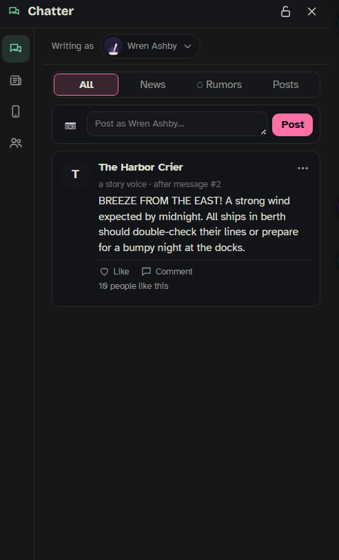

The world layer keeps the world living around your story. While you play, the people of the story text `{{user}}` (or write letters), post and comment in a feed, spread rumors, and the local news reports on what is going on. It lives in its own **World** panel, next to the chat, and it is set up per [[storyboard|Storyboards]]. What happens there flows back into the story: what someone learns from a message joins what they know in the [[Cast]], a meet-up agreed by text becomes one of their plans, and the main character hears the news.

The world layer is **off** unless you switch it on for a board. While it is off, there is no World button, no panel and no AI calls for it.

## Turning it on

1. Open the board (bar 📖 › **Open the board**) and pick the **World** tab.
2. Press **Switch it on**, or **☆ Switch it on and set it up with Mero** (see [Setting it up with Mero](#setting-it-up-with-mero-)).
3. Save the board.

To switch it off again, turn off **Use the world layer in this story** at the top of the World tab's settings and save.

The world layer works in chats that use this board. It needs people to work with: add a Cast on the board first (see [[Cast]]). If the board is paused in a chat (**Story › Pause board**), the world is gone from that chat too.

It uses its own AI connection: **Settings › AI & connections › World**. Until you pick one, it uses the story helper's connection.

## Where it appears

When this chat's board has the world layer on, a 🌍 globe button appears on [[The Bar]]. Colored dots on it show what came in since you last looked: green for messages, orange for rumors, blue for news. Click it to open the **World** panel.

The panel opens on the side opposite the side panel, so both can be open. On a PC it joins the panel tabs, like **My notes**: a click outside it closes it, unless you lock it open (the lock in its header, or right-click the globe while it is open). On a phone it fills the screen under the top bar.

The rail on the side of the panel holds the sections, then two buttons at the bottom: **Pause the world** (⏸, see [Pausing the world](#pausing-the-world)) and the settings button, which opens the board on its World tab.

Chatter and Messages have a **Writing as** row at the top. You can write as `{{user}}`, the main character, anyone in the Cast, the story's voices and regulars, or anonymously through the rumor account.

## The sections

The board chooses a **look**: **📱 Phone** (texting, a social feed) or **✉️ Letters** (letters that take story time, notes pinned to a town board, a gazette). The section names follow the look.

| Phone | Letters | What it shows |
|---|---|---|
| **Chatter** | **Talk of the town** | posts, comments and rumors from the people of the story |
| **News** | **The Gazette** | news articles and world stories told over several days |
| **Messages** | **Letters** | private conversations |
| **People** | **People** | who lives in this world, and how much each gossips, writes and posts |

Chatter, News and Messages can each be switched off on the board. People is always there.

### Chatter

A feed of posts. Write a post yourself in the box at the top (📷 adds a described photo); someone may answer. Each post has **Like** (or **Nod** with letters) and **Comment**, and the ⋯ menu has **Write it again** (not on your own posts: another version; ‹ › flips between them), **Ask Mero about this**, **Edit** and **Delete** (with Undo). The filter at the top shows **All**, **News**, **◌ Rumors** or **Posts**.

Type `@` in any writing box to tag someone; a tagged person may answer. Passers-by stay nameless and only make the numbers ("and 23 others like this").

### News

Articles from the story's news account (named on the board), or from a newspaper voice if the story has one. Tap an article to read it.

- **✍️ Write news**: one news item now, from your idea or as a surprise. You can add a statement: "`{{user}}` says: …".
- **+ Start a world story**: something that happens in town ("twenty sheep stolen overnight"). It is planned in several parts, and the news tells it as the story moves on. **End this story** stops it early.
- When `{{user}}` was involved in something, the news account may ask for a comment in Messages. Your answer goes into the article.

The world also starts a story by itself now and then, one at a time.

### Messages

Your conversations with the main character and the people of the Cast, newest first. **＋ New chat with…** starts one (next to it, **+ New group**); ☆ in a conversation's header pins it to the top.

In a conversation:

- Write and send. They answer in their own voice, from their card, what they want and plan, and what they know.
- With **Replies take their time** on, people answer by how chatty they are, later while busy in the scene with `{{user}}`, and in the morning when it is night on the story clock. The line under their name says asleep, busy, slow to reply or online. **Answer now** makes them reply right away.
- Read receipts (Delivered, Read), ‹ › for another version of their last answer, and Edit / Delete on each message.
- 📷 attaches a described photo.
- **Meet up…**: write what, where and when. It becomes one of their plans, and the story brings it up when the time comes.
- **Leak…**: tick messages and pick who hears them. They know it now. Leaking to the rumor account spreads it.
- **Ask Mero about this conversation**, and **Clear this conversation** (every message and what anyone learned from it; Undo brings the messages back).

**+ New group** (phone look only) starts a group chat with at least three people. You can leave yourself out; then it is a group just for them.

**Between others** (a drawer at the bottom of the list) holds the conversations you are not in: tap one to read it. Only you see this. **+ Start chat** inside it has two people of the story start texting now, about something you give or something of their own.

With the **letters** look, a letter takes story time: it arrives on the next story day (on a board without days, after the next exchange), has no read receipts, and is answered once it has arrived.

What someone learns from a message joins their Cast knowledge, so they know it in the main story too. Each time, a notice with Undo tells you.

### People

Everyone in this world: **Characters** (the main character and the Cast), **Regulars** and **Story voices**, each with dots for how much they gossip, write messages and post, and the **Rumor account**. **Edit people on the board** opens the World tab.

## Rumors

Rumors start from the story (a scene can start one after a reply), from tips sent to the rumor account, and from leaks. They spread by word of mouth: who heard it from whom, sometimes a little changed.

- A rumor post has **◌ What's behind it?**: true, twisted or made up, where it started, who heard it so far, and how it changed when retold.
- **👁 Who posted?** shows who is behind an anonymous rumor. Only you see it.
- Write to the rumor account in Messages to send a tip. It may check with a witness first, over the next exchange or two, before it posts. It never names who tipped it.
- While Chatter is on, each message's 📖 menu has **Start a rumor from this…**: pick who starts it, whether it goes out anonymously, true / twisted / made up, and anything it should hint at.

A story tracker can be moved by news and rumors too, but only if you switch on **News and rumors can move this** in that tracker's settings on the board. It happens rarely, with a notice and Undo each time.

## Setting it up on the board

The board's **World** tab has two parts.

**The page** shows what is going on in the current chat:

- **Lately**: the newest posts and messages, with filters (**All**, **Posts**, **Messages**, **To you**). It shows 3; **＋ more** shows up to 15. The unread count shows what was sent to `{{user}}`.
- **Rumors** going around, with who heard them; **Coming up** (planned messages still waiting; tap one to open it); **World stories**.
- **● Alive / ⏸ Paused** at the top pauses or wakes the world in this chat with one tap.
- **People in the world** and **Voices and regulars** (see below).

**The side panel** has three tabs: **Settings**, **📅 Planned** (with a count) and **☆ Mero**. Tapping a person or a voice on the page opens their card there instead. The Settings groups fold; each title says how it is set (for example "How alive · Normal").

**World layer › Use the world layer in this story**: the main switch.

**How people reach each other**: 📱 Phone or ✉️ Letters.

**Sections**: Chatter, News and Messages on or off.

**How alive**: when the world catches up by itself.

| Setting | Default | What it does |
|---|---|---|
| **Catch up when I open it** | on | when you open the panel after a while away from the world |
| **When something big happens** | on | a public scene, a fight, an accident, news, a party; the story helper notices it in the reading it already does each reply |
| **When story time passes** | on | a new story day (needs a State tracker with a Day field) |
| **Every N exchanges** | off (N = 10) | an exchange is your message and the reply |
| **When nothing is happening** | off | small talk, waiting, everyday routine for a while |
| **Little things after every reply** | on, Normal 0–4 | small moves of the world's own: a post, a comment, an answer, an old post dug up, now and then a text between two people who know each other. **Quiet 0–2**, **Normal 0–4**, **Lively 1–6** or **Your own** range |
| **Replies take their time** | on | off: everyone answers right away |
| **Pause the world** | off | pauses it in this chat: nothing new comes in, and messages wait, until you switch it back |

**News and rumor accounts**: the names of the news account (shown when the story has no newspaper voice) and of the rumor account.

**Pictures**:

- **Photos become real pictures** (on): a 📷 photo in a message is drawn by SillyTavern's Image Generation, with whatever you set up there. Off (or without an image generator), photos stay **described photos**: a photo card with 📷 and a short description of what is in the picture, which needs nothing extra and costs nothing. A drawn photo keeps its description as the picture's caption. It only draws photos in messages from the moment you first look at them; older photos keep a 🎨 button to draw them by hand. It needs SillyTavern's Image Generation extension switched on.
- **People send photos too** (on): now and then, when it fits. Off: only the photos you send.

**Who can write to you first**: **The Cast** and the main character, each on or off.

**📅 Planned** (side panel tab): **+ Plan a message** sets up a message, a post, news or a rumor that goes out when something happens in the story: a story day, a tracker reaching a step, the scene being at a place, or someone arriving. You can add a second condition (both must hold) and a chance ("1 in 3"). The words are either **My exact words** or **My note, the AI writes it** in the sender's voice when it goes out.

**People in the world** (on the page): one row per person, with three dials (**G**ossips, **M**essages, **P**osts; tap a dial to change it: low, avg, high, and never for Gossips and Posts) and a bar for how active they were in this chat. Tap a name to open their card in the side panel: their dials, what they did lately, the rumors they heard, what they care about, their quirks (how they write, in your own words: "sends several short texts in a row", "never uses capitals"), who they **never talk to** (both ways) and who they **never gossip about**. 🔇 mutes someone in the world: they never write to you first or post, and their answers wait until you unmute them. ✕ takes them out of the world entirely; they stay in your scenes. ↩ brings them back.

**Voices and regulars** (on the page): **+ Voice** adds an institution or publication (a local paper, a shop, a guild board); **+ Regular** adds a recurring local with a personality (a gossip, a grump). Tap one to edit it in the side panel: a name, who they are, quirks, the three dials, what they care about, and Muted.

### Setting it up with Mero ☆

The side panel's **☆ Mero** tab (or **☆ Set up with Mero** on a new world): tell [[Mero]] ☆ about this world in a few words, or leave it empty. She reads the board, its note and the people's cards, and proposes the look, how alive it is, names for the news and rumor accounts, voices and regulars, and how each person writes. Tick what you keep and press **Use the ticked**, then save the board.

## Pausing the world

**⏸ Pause the world** on the panel's rail (or **● Alive** at the top of the board's World tab, or **Pause the world** in its settings) pauses the world **in this chat**: nothing comes in by itself (no catch-ups, no little moves, no planned messages, no photos drawn), and a message you send waits and is answered once the world wakes. You can still read everything, and the 🌐 World button on the bar shows a small ⏸ while it is paused. Press ▶ (**Wake the world**) to start it again. Other chats on the same board keep running.

Pausing is not the same as not using the world: a board without the world layer has no World button, no panel and no AI calls at all. To switch it off for a story, turn off **Use the world layer in this story** on the board. **Story › Pause board** pauses the whole board in a chat, and the world with it.

## How the world and the story connect

- **The writing model** is told what the main character knows from messages, plans made with the main character, the latest public news, and rumors the main character has heard.
- **The Cast**: what people learn from messages and rumors joins their knowledge, with Undo; meet-ups become their plans.
- **[[Mero]] ☆** gets a short summary of the world, and you can attach posts, news, rumors or conversations to a talk with her (📎, or **Ask Mero about this**).
- **Deleting** a main-chat message takes back what the world wrote at it. Swiping or regenerating the main reply does not touch the world; each post, article and message has its own Write again, Edit and Delete instead.

## What it costs

Every text call runs on the World connection (**Settings › AI & connections › World**), except **☆ Set up with Mero**, which runs on Mero's. The world waits until nothing is being written in the main chat before its own follow-ups, so it never slows down your replies.

**By itself** (none of this happens while the world is paused or switched off):

| When | Calls |
|---|---|
| A catch-up (your "How alive" mix says so) | up to three: who writes to `{{user}}` now (if Messages is on), the feed and news (if Chatter or News is on), rumors (if Chatter is on and there is something to start or pass on) |
| After each reply, **Little things after every reply** | one (skipped at a reply that already had a catch-up) |
| After each reply, a conversation between others | at most one answer, and not more often than every 4 main-chat messages, plus one small call for what was learned |
| The rumor account checking a tip with a witness | over two exchanges: one for its question, then one for the witness's answer, one small call for what they learned, and one to write the post |
| A planned message with **My note, the AI writes it** | one when it goes out (**My exact words**: none); a message to someone other than `{{user}}` adds one small call for what they learned, with either kind of words |
| A delayed group answer | one per member who answers later |
| "Big" and "quiet" moments | none: an extra field in the story helper's usual call |

**When you do something:**

| What | Calls |
|---|---|
| Send a message to someone | one for the answer, plus one small call for what they learned and whether a meet-up was agreed |
| Send a tip to the rumor account | one for its answer, plus one or two to write the post |
| Send a message in a group | one (the members who answer now) |
| Post or comment in Chatter | one (who reacts) |
| **Write it again**, or › for another version | one |
| **✍️ Write news** | one |
| **+ Start a world story** | two (plan it, then the first news) |
| **+ Start chat** (Between others) | two (the first message and the answer), plus one small call for what was learned |
| **Start a rumor from this…** | one |
| **☆ Set up with Mero** | one, on Mero's connection |
| Like, Meet up, Leak (to people), pinning, editing, deleting | none |

**Pictures** are separate: each drawn photo is one image made by SillyTavern's Image Generation, not a text call. At most three are drawn at a time, one after the other. If one fails, drawing by itself stops until one works by hand (🎨).

## Good to know

- A message you send while someone is muted waits, and is answered once you unmute them.
- Each chat has its own world. Opening another chat never gets this chat's answers.
- Deleting a post, a news item or a whole conversation shows a notice with Undo.

See also: [[Storyboards]], [[Cast]], [[Mero]], [[The Bar]].
